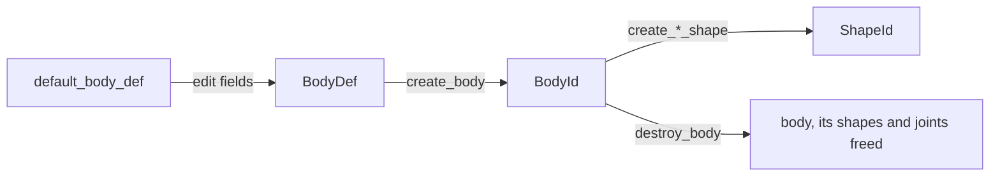

# Bodies

[Documentation](../index.md) › [Public API](index.md) › Bodies

Rigid bodies: definition, creation and destruction, pose, velocity, forces and impulses, mass,
sleep and enable state, per-body flags, and the accessors that list a body's shapes, joints and
contacts. Everything here is in module `b3`. A body has no geometry of its own; attach
[shapes](shapes.md) to give it collision and mass.



## Create and destroy

```c3
b3::BodyDef def = b3::default_body_def();
def.type = b3::BodyType.DYNAMIC;
def.position = { 0.0f, 4.0f, 0.0f };
def.name = "crate";
def.user_data = &crate_entity;
b3::BodyId body = b3::create_body(world, &def)!;

b3::ShapeDef shape_def = b3::default_shape_def();
b3::BoxHull box = b3::make_box_hull(0.5f, 0.5f, 0.5f);
b3::create_hull_shape(body, &shape_def, &box.base)!;
```

`create_body` returns `INVALID_DEFINITION` for a null definition or one that did not come from
`default_body_def`. It returns `INVALID_HANDLE` when the world is locked (mid step, or inside a
callback the step runs).

`default_body_def` gives a `STATIC` body at the origin with identity rotation, gravity scale 1,
sleeping allowed, awake, enabled, contact recycling on, and a sleep threshold of 0.05 m/s scaled
by the [length unit](library_and_math.md#length-units). Other `BodyDef` fields set the initial
velocities, damping, `motion_locks`, `is_bullet` and `allow_fast_rotation`. `safety_factor`
(default 0.5) sets when continuous collision treats the body as fast: when one step moves it more
than that share of its smallest extent. The wrapper checks only the definition marker: a zero
quaternion, a non-finite position, negative damping or a negative safety factor is passed to box3d
unchecked.

| `BodyType` | Mass | Moved by |
|---|---|---|
| `STATIC` | zero | the caller only (`set_transform`) |
| `KINEMATIC` | zero | its velocity; unaffected by forces and contacts |
| `DYNAMIC` | positive | forces, contacts and joints |

```c3
b3::destroy_body(body);                                // its shapes and joints go too
```

`destroy_body` destroys every shape and joint attached to the body. Ids held for them become
invalid. `destroy_world` destroys all bodies, so a body owned for the life of its world needs no
explicit destroy.

`body.type()` and `body.set_type(t)` read and change the type. Changing it is expensive and
recomputes mass from the shapes. `body.world()` returns the owning world.

## Pose

```c3
b3::WorldTransform pose = body.transform();
b3::Pos tip = body.world_point({ 0.5f, 0.5f, 0.5f });
b3::Vec3 back = body.local_point(tip);                 // (0.5, 0.5, 0.5)
body.set_transform({ 0.0f, 6.0f, 0.0f }, pose.q);      // teleport
```

`position()`, `rotation()` and `transform()` give the body origin's pose. `world_point` and
`local_point` convert points between body and world frames; `world_vector` and `local_vector`
convert directions. `local_center()` and `world_center()` give the centre of mass, which is not
the origin when shapes are offset.

`set_transform(position, rotation)` teleports the body. It is expensive; create bodies at their
intended pose instead. The rotation must be a unit quaternion; nothing checks it.

### Kinematic targets

```c3
b3::BodyDef platform_def = b3::default_body_def();
platform_def.type = b3::BodyType.KINEMATIC;
b3::BodyId platform = b3::create_body(world, &platform_def)!;
b3::WorldTransform target = { .p = { 2.0f, 0.0f, 0.0f }, .q = platform.rotation() };
platform.set_target_transform(target, 1.0f / 60.0f, true);
b3::world_step(world, 1.0f / 60.0f, 4);
```

`set_target_transform(target, time_step, wake)` sets the velocity that reaches `target` after one
step of `time_step`. It is meant for kinematic bodies. An awake body always takes the
velocity. A sleeping body is left asleep when `wake` is false, or when the needed velocity is
below its sleep threshold; otherwise it is woken and takes the velocity.

## Velocity, forces and impulses

```c3
body.set_linear_velocity({ 1.0f, 0.0f, 0.0f });
b3::body_apply_force_to_center(body, { 0.0f, 50.0f, 0.0f }, true);
b3::body_apply_linear_impulse(
  body: body,
  impulse: { 0.0f, 0.0f, 2.0f },
  point: body.world_point({ 0.5f, 0.0f, 0.0f }),
  wake: true,
);
b3::body_apply_torque(body, { 0.0f, 1.0f, 0.0f }, true);
```

| Call | Effect |
|---|---|
| `body_apply_force(body, force, point, wake)` | force at a world point; off-centre adds torque |
| `body_apply_force_to_center(body, force, wake)` | force at the centre of mass |
| `body_apply_torque(body, torque, wake)` | torque |
| `body_apply_linear_impulse(body, impulse, point, wake)` | immediate velocity change at a world point |
| `body_apply_linear_impulse_to_center(body, impulse, wake)` | immediate velocity change at the centre of mass |
| `body_apply_angular_impulse(body, impulse, wake)` | immediate angular velocity change |

All vectors are in world space. Forces accumulate, apply during the next step, and then reset to
zero, so a sustained force is applied before every step. A force or impulse on a
sleeping body is ignored unless `wake` is true. Use impulses for one-shot changes and forces for
anything sustained; the sub-stepping solver handles forces better.

`linear_velocity()`, `angular_velocity()`, `set_linear_velocity(v)` and `set_angular_velocity(v)`
read and write the centre-of-mass velocity. `local_point_velocity(p)` and
`world_point_velocity(p)` give the velocity of a point fixed to the body.

## Mass

```c3
b3::MassData mass = body.mass_data();                  // from shape density
mass.mass *= 2.0f;
mass.inertia = mass.inertia * 2.0f;
body.set_mass_data(mass);
b3::body_apply_mass_from_shapes(body);                 // back to the shapes' values
```

box3d computes mass from shape density when shapes are added. `MassData` holds `mass`, `center`
(local) and `inertia` (a column-major [`Matrix3`](library_and_math.md#matrix3-is-column-major)
about the centre of mass). `set_mass_data` overrides it until a shape is added or removed or the
type changes. `body_apply_mass_from_shapes` recomputes it from the shapes; call it after
replacing shape geometry or after creating shapes with `ShapeDef.update_body_mass` off.

Read-only: `mass()`, `inverse_mass()`, `local_rotational_inertia()`,
`world_inverse_rotational_inertia()`, `local_center()`, `world_center()`.

## Sleep, enable and flags

```c3
body.enable_sleep(false);                              // also wakes it
body.set_motion_locks({ .angular_x = true, .angular_z = true });
b3::body_disable(body);                                // out of the simulation, still valid
b3::body_enable(body);
```

- `set_awake(true)` wakes the body's island. `set_awake(false)` puts the whole island to sleep,
  which can be expensive. `is_awake()` reads the state.
- `enable_sleep(flag)` allows or forbids sleep for this body; disabling it wakes the body.
  `set_sleep_threshold(v)` sets the speed below which it may sleep.
- `body_disable(body)` removes the body from the simulation and `body_enable(body)` puts it back.
  Both are expensive. A disabled body is still valid, keeps its shapes, and can still be jointed.
  `is_enabled()` reads the state.
- `set_motion_locks(locks)` takes a `MotionLocks` of six flags, `linear_x` to `angular_z`, and
  locks the named axes.
- `set_bullet(true)` gives the body continuous collision against other dynamic bodies (not other
  bullets). Continuous collision against static bodies is on by default for every dynamic body.
- `body_allow_fast_rotation(body, true)` lifts the rotation-speed clamp, for bodies that spin
  fast only about a symmetry axis, such as wheels.
- `enable_contact_recycling(flag)` affects only contacts created after the call.
- `enable_hit_events(flag)` sets `enable_hit_events` on every shape of the body.

Each setter has a getter: `is_sleep_enabled`, `sleep_threshold`, `motion_locks`, `is_bullet`,
`is_fast_rotation_allowed`, `is_contact_recycling_enabled`. Damping and gravity scale are
`linear_damping()`, `angular_damping()` and `gravity_scale()`, set with `set_linear_damping(v)`,
`set_angular_damping(v)` and `set_gravity_scale(v)`.

`compute_aabb()` returns the union of the body's shape bounds, a zero-size box at the body origin
when it has no shapes, and a zero box while the world is locked.

## Shapes, joints and contacts of a body

```c3
b3::ShapeId[8] shape_buffer;
foreach (shape : body.shapes(shape_buffer[..])) {
    // each attached shape; shape_count() is exact
}
b3::JointId[8] joint_buffer;
b3::JointId[] joints = body.joints(joint_buffer[..]);  // newest first
```

These fill a caller buffer and return the filled prefix; nothing is allocated. They are declared
on other pages:

| Accessor | Count | Page |
|---|---|---|
| `body.shapes(buffer)` | `body.shape_count()`, exact | [queries and casts](queries_and_casts.md) |
| `body.joints(buffer)` | `body.joint_count()`, exact; newest joint first | [joints](joints.md) |
| `body.contact_data(buffer)` | `body.contact_capacity()`, an upper bound; zero while locked | [queries and casts](queries_and_casts.md) |

A result as long as the buffer may be truncated. Size the buffer from the count first.

## Name and user data

```c3
Entity* entity = body.user_data();
ZString name = body.name();                            // "crate", copied by box3d
```

`set_name(name)` copies the string, so it need not outlive the call. `name()` returns an empty
string when none is set. `set_user_data(p)` and `user_data()` store one pointer for the caller;
box3d never dereferences it. [`BodyMoveEvent`](worlds.md#events) carries the same pointer.

## Contracts

- Always start from `default_body_def()`. `create_body` refuses an unmarked definition with
  `INVALID_DEFINITION` and a locked world with `INVALID_HANDLE`.
- Values inside the definition and passed to setters are not validated. Check input with the
  [validity predicates](library_and_math.md#validity-predicates) where it matters.
- Do not mutate a body while its world is locked. Some setters are silently ignored on a locked
  world; others proceed unchecked.
- A call on a destroyed body's id is undefined behaviour. Test `body.is_valid()` before using an id
  held across frames or taken from an event.
- `destroy_body` also destroys the body's shapes and joints.
- `set_mass_data` is lost when shapes change or the type changes.
- Forces and impulses on a sleeping body need `wake = true`.
- Buffer accessors may truncate silently; `contact_capacity()` is an upper bound, not a count.
