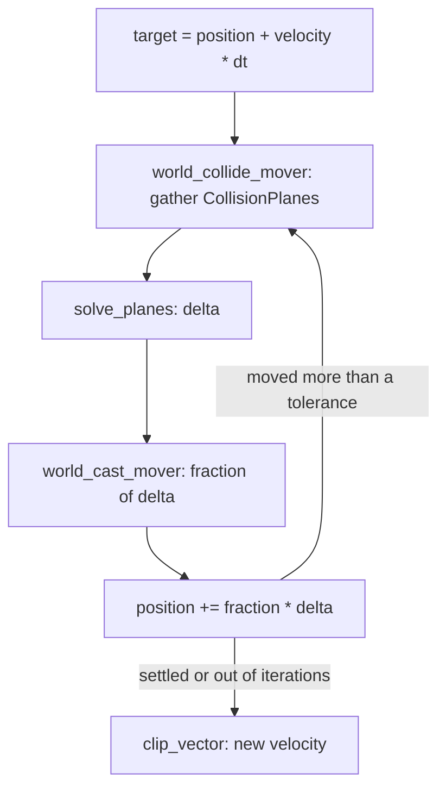

# Character mover

[Documentation](../index.md) › [Public API](index.md) › Character mover

A geometric character mover: a capsule that is not a body, moved by application code against the
world's shapes. It collects contact planes, solves a position against them, sweeps the result
through the world, and clips the velocity. This page also covers radial explosions, which share
the source file. Source: `src/mover.c3i` and its wrapper.

The mover is not simulated. Nothing pushes it, and it pushes nothing unless the application
applies impulses to the bodies it touches.



## A move step

```c3
const int MAX_MOVER_PLANES = 32;
const int MAX_MOVER_ITERATIONS = 5;
const float MOVER_TOLERANCE = 0.01f;

struct MoverPlanes {
    b3::CollisionPlane[MAX_MOVER_PLANES] planes;
    int count;
}

fn bool gather_planes(b3::ShapeId shape, b3::PlaneResult* results, int result_count, void* context) {
    MoverPlanes* gathered = context;
    for (int i = 0; i < result_count && gathered.count < MAX_MOVER_PLANES; i++) {
        gathered.planes[gathered.count] = {
            .plane = results[i].plane,
            .push_limit = float::max,
            .clip_velocity = true,
        };
        gathered.count++;
    }
    return true;
}

fn b3::Pos move_character(
  b3::WorldId world,
  b3::Pos position,
  b3::Capsule* mover,
  b3::Vec3* velocity,
  float dt,
) {
    b3::QueryFilter filter = b3::default_query_filter();
    b3::Pos target = (b3::Pos)(position + *velocity * dt);
    MoverPlanes gathered;

    for (int iteration = 0; iteration < MAX_MOVER_ITERATIONS; iteration++) {
        gathered.count = 0;
        b3::world_collide_mover(
          world: world,
          origin: position,
          mover: mover,
          filter: filter,
          fcn: &gather_planes,
          context: &gathered,
        );

        b3::CollisionPlane[] planes = gathered.planes[:gathered.count];
        b3::PlaneSolverResult solved = b3::solve_planes(target - position, planes);

        float fraction = b3::world_cast_mover(
          world: world,
          origin: position,
          mover: mover,
          translation: solved.delta,
          filter: filter,
          fcn: null,
          context: null,
        );

        b3::Vec3 delta = solved.delta * fraction;
        position = (b3::Pos)(position + delta);
        if (delta.dot(delta) < MOVER_TOLERANCE * MOVER_TOLERANCE) break;
    }

    *velocity = b3::clip_vector(*velocity, gathered.planes[:gathered.count]);
    return position;
}
```

The mover capsule is defined relative to `position`, which every call takes as `origin`. With
`center1` at `{ 0, 0.35f, 0 }`, `center2` at `{ 0, 1.45f, 0 }` and radius 0.35, `position` is the
character's feet.

Each iteration:

1. **Collect.** `b3::world_collide_mover` calls `gather_planes` once per shape the capsule
   touches, with that shape's `PlaneResult` values. The callback turns each into a
   `CollisionPlane`. The planes are relative to `origin`.
2. **Solve.** `b3::solve_planes` moves the wanted displacement `target - position` out of every
   plane it violates and returns the corrected `delta`. It writes each plane's `push`.
3. **Sweep.** `b3::world_cast_mover` sweeps the capsule along `delta` and returns the fraction it
   can travel before hitting something new.
4. **Advance.** The position moves by that fraction of `delta`. A step shorter than the tolerance
   means the mover has settled.

After the loop, `b3::clip_vector` removes the velocity component running into the planes the
solve leaned on, so the character slides along walls and floors instead of building velocity into
them. A character falling onto a floor at `{ 1, -2, 0 }` comes out with velocity `{ 1, 0, 0 }`,
resting one linear slop inside the floor.

## Collecting planes

`b3::world_collide_mover` traverses the world's static, kinematic and dynamic shapes that pass the
`QueryFilter` and calls a `PlaneResultFn` once per shape. The callback is required.

- A sphere, capsule or hull gives one plane. A mesh, height field or compound gives up to 64; any
  more are dropped without a report. A mesh or height-field triangle gives a plane only when the
  mover's centre is on its wound side.
- `PlaneResult.plane` has its normal pointing out of the shape towards the mover; its offset is
  how far the mover's surface reaches past the shape's. `PlaneResult.point` lies on the shape's
  core (sphere centre, capsule segment, hull face), not its surface.
- `PlaneResult.triangle_index` names the mesh or height-field triangle and `child_index` the
  compound child; each is 0 for any other shape. `material_index` is the triangle's material
  index, or for a compound the index into its materials; 0 for a convex shape.
- When the mover's core comes within a linear slop of a shape's core, the normal is an arbitrary
  perpendicular of the mover's axis. A hull or triangle stops reporting once the mover's core
  reaches its surface, so a mover sunk deeper than its radius has nothing to solve against.
- The `PlaneResult` array lives on box3d's stack for the duration of the call. Copy what you keep.
- Returning false stops the traversal of the current tree only; the other two trees still report.
- A locked world, or an invalid origin, reports nothing.

A `CollisionPlane` is what the solver consumes: the `plane`, a `push_limit` capping how far this
plane may move the mover (`float::max` for no cap), the solver's output `push`, and
`clip_velocity`. Setting a small `push_limit` or `clip_velocity = false` for a shape lets the
character push through or ignore it in the velocity clip.

## Solving

`b3::solve_planes(target_delta, planes)` returns a `PlaneSolverResult`:

- `delta` is the corrected displacement. A delta the planes had to move rests one linear slop
  inside them.
- `iteration_count` is the zero-based index of the pass that converged. 20 means no pass did, and
  `delta` is whatever the last pass left.
- Every plane's `push` is overwritten from zero; incoming values are ignored. An empty slice is
  valid and returns the target unchanged.

## Sweeping

`b3::world_cast_mover` returns the fraction of `translation` the capsule can travel, above zero up
to 1. The optional `MoverFilterFn` is called once per shape before that shape is swept; returning
false drops it. Pass null to accept every shape the query filter passes.

- A shape whose surface the capsule's core starts within the closing band of is dropped from the
  sweep; the collide and solve steps handle that shape instead. For a capsule thinner than about a
  linear slop the band reaches past its own surface, so give the mover a real radius.
- The stop carries the same slop band as other shape casts: short of the geometric touch below a
  total radius of one slop, past it above. See [Geometry](geometry.md#shape-cast).
- A locked world, or an invalid origin or translation, returns 1.

## Clipping velocity

`b3::clip_vector(vector, planes)` removes from `vector` the component running into each plane and
keeps components running away. A plane is skipped when its `clip_velocity` is false or its `push`
is zero. Only a plane the last `solve_planes` had to push has a non-zero `push`, so a slice that
was never solved clips nothing.

## Planes against one body

```c3
b3::BodyPlaneResult[16] buffer;
b3::BodyPlaneResult[] touching = b3::body_collide_mover(
  body: platform,
  buffer: buffer[..],
  origin: position,
  mover: mover,
  filter: b3::default_query_filter(),
  body_transform: platform.transform(),
);
foreach (hit : touching) {
    b3::Plane plane = hit.result.plane;
}
```

`b3::body_collide_mover` collides the capsule with one body's shapes under a transform the caller
supplies, for example a moving platform's predicted pose. It writes one `BodyPlaneResult` (shape
id and `PlaneResult`) per touching shape and returns the filled prefix of `buffer`. Only spheres,
capsules and hulls are considered. A buffer that fills up drops the rest without a report. A
locked world fills nothing.

## Explosions

```c3
b3::ExplosionDef blast = b3::default_explosion_def();
blast.position = { 0, 1, 0 };
blast.radius = 2.0f;
blast.falloff = 1.0f;
blast.impulse_per_area = 10.0f;
b3::world_explode(world, blast)!;
```

`b3::world_explode` applies a radial impulse to every dynamic body with a shape in reach. The
impulse is full inside `radius`, fades to zero across `falloff` beyond it, and scales with the
area each shape presents to the blast and its `ShapeDef.explosion_scale`. A negative
`impulse_per_area` pulls inwards. `mask_bits` selects which shape categories are affected.

- `b3::default_explosion_def()` returns an `ExplosionDef` that moves nothing: every mask bit set,
  position at the origin, radius, falloff and impulse zero. Fill in the fields you need.
- `world_explode` returns `INVALID_DEFINITION` for a non-finite position, a negative or non-finite
  radius or falloff, or a non-finite impulse.
- Static and kinematic bodies never move, and a locked world does nothing.
- A **mesh shape on a dynamic body** inside the axis-aligned box of half-width
  `radius + falloff` around the position crashes box3d, even in the box's corners outside the reach. Exclude it through
  `mask_bits` or give it an `explosion_scale` of 0.

## Contracts

- The mover is a capsule relative to `origin`; every plane and point reported is relative to the
  same origin.
- `world_collide_mover` needs a callback. Copy plane results out of the callback; the array dies
  with the call.
- Mesh, height field and compound shapes report at most 64 planes each.
- `solve_planes` overwrites `push`; `clip_vector` reads it. Clip with the planes from the last
  solve.
- Mover callbacks run synchronously on the calling thread and must not modify the world.
- A locked world makes the collide calls report nothing and `world_cast_mover` return 1.
- `world_explode` crashes on a mesh shape on a dynamic body unless the mask or the shape's
  `explosion_scale` excludes it.
