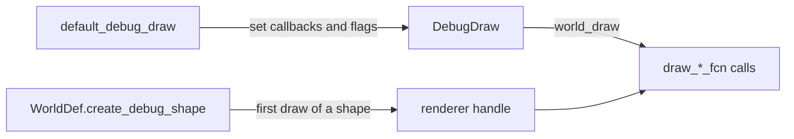

# Debug draw

[Documentation](../index.md) › [Public API](index.md) › Debug draw

Drawing a world through renderer callbacks: the `DebugDraw` callback table and flags, per-shape
renderer handles, and the constraint graph colours. Everything here is in module `b3::draw`,
reached by `import b3;`. Callback parameter types (`Pos`, `WorldTransform`, `Aabb`) are in `b3`.



## Draw a world

```c3
fn void draw_segment(b3::Pos p1, b3::Pos p2, draw::HexColor color, void* context) {
    LineBatch* batch = context;
    batch.segment_count++;
}

fn void draw_shape(void* user_shape, b3::WorldTransform transform, draw::HexColor color, void* context) {
    LineBatch* batch = context;
    batch.shape_count++;
}
```

```c3
draw::DebugDraw debug = draw::default_debug_draw();
debug.draw_shape_fcn = &draw_shape;
debug.draw_segment_fcn = &draw_segment;
debug.context = &batch;
debug.draw_shapes = true;
debug.draw_joints = true;
debug.drawing_bounds = { .lower_bound = { -50.0f, -50.0f, -50.0f }, .upper_bound = { 50.0f, 50.0f, 50.0f } };
draw::world_draw(world, &debug, ulong::max);
```

`default_debug_draw` returns a table with every flag false, callbacks that do nothing (not null),
drawing bounds of 100 length units either side of the origin, and `force_scale` and `joint_scale`
of 1. Raise the flags you want and replace the matching callbacks.

`world_draw(world, &debug, mask_bits)` draws everything inside `drawing_bounds` whose shape filter
categories overlap `mask_bits`. A mask of 0 draws nothing; `ulong::max` draws everything.
`context` is passed to every callback. Call it between steps: on a locked world it draws nothing.

| Callback | Draws |
|---|---|
| `draw_shape_fcn` (`DrawShapeFn`) | a shape, through its renderer handle, at its body's pose |
| `draw_segment_fcn` (`DrawSegmentFn`) | a line segment |
| `draw_transform_fcn` (`DrawTransformFn`) | a coordinate frame |
| `draw_point_fcn` (`DrawPointFn`) | a point with a size |
| `draw_sphere_fcn` (`DrawSphereFn`) | a sphere with alpha |
| `draw_capsule_fcn` (`DrawCapsuleFn`) | a capsule with alpha |
| `draw_bounds_fcn` (`DrawBoundsFn`) | an axis-aligned box |
| `draw_box_fcn` (`DrawBoxFn`) | an oriented box from half extents and a transform |
| `draw_string_fcn` (`DrawStringFn`) | text at a world position |

Flags: `draw_shapes`, `draw_joints`, `draw_joint_extras`, `draw_bounds`, `draw_mass`,
`draw_sleep`, `draw_body_names`, `draw_contacts`, `draw_anchor_a`, `draw_graph_colors`,
`draw_contact_features`, `draw_contact_normals`, `draw_contact_forces`, `draw_islands`.
`force_scale` and `joint_scale` scale drawn forces and joint glyphs.

`HexColor` is a `uint` packed as `0xRRGGBB`. box3d may also pass a shape's custom colour and
packs a debug material preset into the high byte, so mask with `0xFFFFFF` for plain RGB.

## Shape handles

Shapes are drawn through renderer-side handles that box3d stores per shape. The handles come from
two world-definition callbacks; without `create_debug_shape`, `draw_shapes` draws nothing.

```c3
struct RenderShape {
    b3::ShapeType type;
    float radius;
}

fn void* create_render_shape(draw::DebugShape* debug_shape, void* context) {
    RenderShape* shape = mem::new(RenderShape, { .type = debug_shape.type });
    if (debug_shape.type == b3::ShapeType.SPHERE) shape.radius = debug_shape.sphere.radius;
    return shape;
}

fn void destroy_render_shape(void* user_shape, void* context) {
    free(user_shape);
}
```

```c3
b3::WorldDef def = b3::default_world_def();
def.create_debug_shape = &create_render_shape;
def.destroy_debug_shape = &destroy_render_shape;
b3::WorldId world = b3::create_world(&def)!;
defer b3::destroy_world(world);
```

`create_debug_shape` (`b3::CreateDebugShapeFn`) runs the first time `world_draw` reaches a shape
with `draw_shapes` raised. It receives a `DebugShape` and `WorldDef.user_debug_shape_context`, and
returns a handle that box3d keeps and passes to `draw_shape_fcn` on every later draw. A null
return means the shape is not drawn, and box3d asks again on the next draw.

`destroy_debug_shape` (`b3::DestroyDebugShapeFn`) releases a handle when its shape's geometry is
replaced (`set_sphere`, `set_capsule`, `set_hull`, `set_mesh`), when the shape, its body or its
world is destroyed. After a geometry change the next draw creates a new handle.

`DebugShape` carries `shape_id`, `type`, and a union with one arm per `ShapeType`: `sphere`,
`capsule`, `hull`, `mesh`, `compound`, `height_field`. Read only the arm `type` names; the others
reinterpret the same pointer. The `sphere`, `capsule` and `mesh` arms point into the world's shape
storage, which moves when shapes are added, so read them inside the callback and copy what the
renderer needs. The `compound` and `height_field` arms point at the caller's own geometry.

The callbacks can only be set at world creation. A replay player sets its own with
[`player.set_debug_shape_callbacks`](recording.md#draw-a-replay).

## Graph colours

```c3
for (int slot = 0; slot < draw::GRAPH_COLOR_COUNT; slot++) {
    draw::HexColor color = draw::graph_color(slot)!;
    uint red = (color >> 16) & 0xFF;
}
```

`graph_color(index)` returns the colour box3d uses for a constraint graph slot, for drawing the
solver's colouring. `GRAPH_COLOR_COUNT` is 24; the last slot is the overflow colour. An index
outside `0..GRAPH_COLOR_COUNT - 1` returns `INDEX_OUT_OF_RANGE`.

## Contracts

- Every callback whose flag is raised must be non-null. box3d calls it without a check, so a null
  callback under a raised flag crashes. `default_debug_draw()` fills all nine with no-ops.
- `drawing_bounds` must be a valid box (finite, lower not above upper). box3d does not check it.
- `mask_bits` of 0 draws nothing.
- A world that sets `create_debug_shape` must also set `destroy_debug_shape`. box3d calls it
  without a null check when a shape is destroyed.
- Read a `DebugShape` arm only inside `create_debug_shape`, and only the arm `type` names.
- `world_draw` draws nothing while the world is locked.
- The draw callbacks run on the thread that calls `world_draw`.
