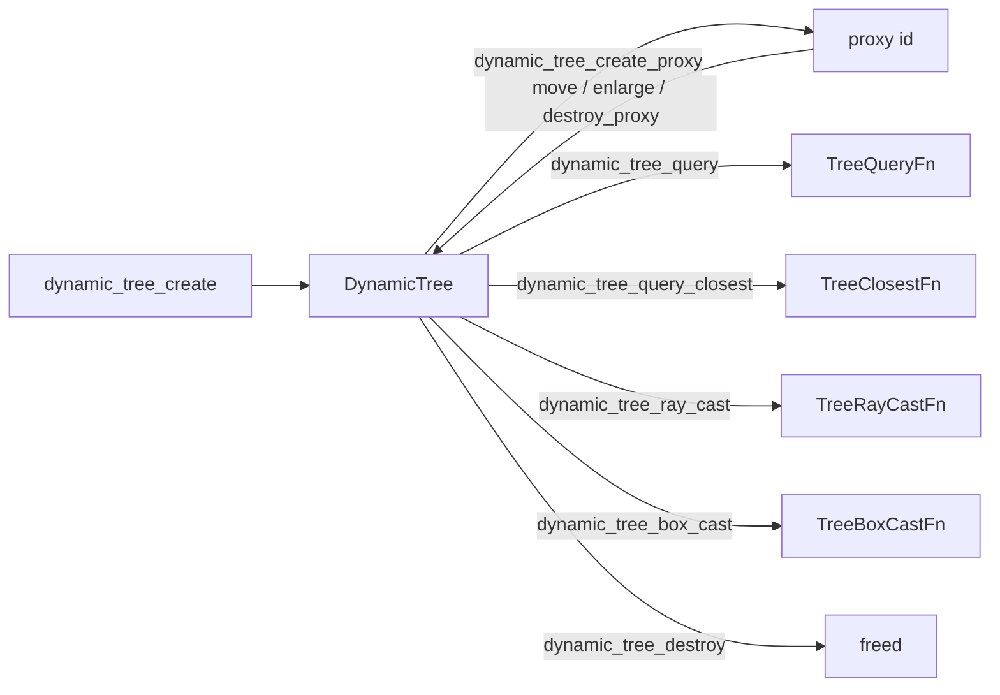

# Dynamic tree

[Documentation](../index.md) › [Public API](index.md) › Dynamic tree

A standalone bounding volume hierarchy over axis-aligned boxes, the structure box3d's broad phase
and compounds are built on. It needs no world. Use it to index your own objects for box queries,
nearest-object searches and ray or box sweeps. Source: `src/tree.c3i` and its wrapper.



## Creating and destroying

```c3
b3::DynamicTree tree = b3::dynamic_tree_create(64);
defer b3::dynamic_tree_destroy(&tree);
```

`b3::dynamic_tree_create` returns a `DynamicTree` by value: an 80-byte struct pointing at a node
pool box3d allocates. The argument is a starting size, never a ceiling; anything below 16 becomes
16, and the pool grows as needed. The pool counts toward `b3::byte_count()` until
`b3::dynamic_tree_destroy`.

- Pass the tree as `&tree`. A copy of the struct shares the same pool, so only one copy may be
  destroyed, and a copy goes stale as soon as the pool grows.
- `dynamic_tree_destroy` frees the pool and zeroes the struct; a second call frees nothing. After
  destroy, `height()`, `area_ratio()` and `root_bounds()` read freed memory and crash, and
  `dynamic_tree_create_proxy` writes through the null pool. Do not reuse a destroyed tree; create
  a new one.
- A compound's `tree` field belongs to the compound. Never destroy it or create proxies in it; see
  [Shapes](shapes.md#compounds).

## Proxies

```c3
b3::Aabb box = { .lower_bound = { -1, -1, -1 }, .upper_bound = { 1, 1, 1 } };
int proxy = b3::dynamic_tree_create_proxy(
  tree: &tree,
  aabb: box,
  category_bits: 1,
  user_data: 42,
)!;

b3::Aabb moved = { .lower_bound = { 3, -1, -1 }, .upper_bound = { 5, 1, 1 } };
b3::dynamic_tree_move_proxy(&tree, proxy, moved)!;
ulong payload = tree.user_data(proxy)!;
b3::Aabb stored = tree.aabb(proxy)!;
```

A proxy is a box, a 64-bit category mask and 64 bits of user data, named by an `int` id.

| Call | Effect |
|---|---|
| `b3::dynamic_tree_create_proxy` | inserts a proxy and returns its id |
| `b3::dynamic_tree_move_proxy` | removes and reinserts the proxy under a new box |
| `b3::dynamic_tree_enlarge_proxy` | widens the proxy's box and every ancestor that does not contain it |
| `b3::dynamic_tree_destroy_proxy` | removes the proxy and frees its id |
| `tree.user_data(id)`, `tree.aabb(id)` | the proxy's payload and stored box |
| `tree.category_bits(id)`, `tree.set_category_bits(id, bits)` | the proxy's category mask |

The tree does not fatten boxes. Callers that move proxies every frame usually insert an enlarged
box and call `move_proxy` only when the object leaves it.

`create_proxy`, `move_proxy` and `enlarge_proxy` return `INVALID_DEFINITION` for a box that is
inverted or not finite. A zero-size box is valid. `enlarge_proxy` marks every ancestor for the
next partial rebuild, even when no box changed.

### Proxy id validity

Every call that takes an id checks it before box3d indexes the node array:

| Id | Result |
|---|---|
| negative, or at or past `node_capacity` | `INDEX_OUT_OF_RANGE` |
| in range, but an internal node or a free slot | `NOT_A_PROXY` |
| a destroyed id whose slot a newer proxy now holds | passes, and names the newer proxy |

Proxy ids carry no generation. `create_proxy` reuses a freed id immediately, so an id held past
`destroy_proxy` can silently name a different proxy. Clear your copy of an id when you destroy
it. Destroying an id twice returns `NOT_A_PROXY` the second time, unless the slot was reused in
between.

## Box query

```c3
fn bool collect_hit(int proxy_id, ulong user_data, void* context) {
    (*(int*)context)++;
    return true;
}
```

```c3
int hits;
b3::Aabb region = { .lower_bound = { 0, -2, -2 }, .upper_bound = { 6, 2, 2 } };
b3::TreeStats stats = b3::dynamic_tree_query(
  tree: &tree,
  aabb: region,
  mask_bits: ulong::max,
  require_all_bits: false,
  fcn: &collect_hit,
  context: &hits,
);
```

`b3::dynamic_tree_query` calls a `TreeQueryFn` for every proxy whose box overlaps `aabb`, until
the callback returns false. It returns `TreeStats` (`node_visits`, `leaf_visits`) as diagnostics.

Masks: with `require_all_bits` false a proxy passes when its category shares any bit with
`mask_bits`; with it true the proxy must carry every bit of the mask. The two agree only for a
single-bit mask. A zero mask passes nothing loosely and everything strictly.

The traversal uses a fixed stack of 1024 entries. A degenerate tree of about a thousand nested
boxes overflows it, and the overflowing subtree is skipped without any report. Ordinary trees stay
far below that depth.

## Closest query

```c3
fn float nearest_point(float search_bound, int proxy_id, ulong user_data, void* context) {
    float distance_squared = (float)user_data;
    return distance_squared < search_bound ? distance_squared : search_bound;
}
```

```c3
b3::ClosestSearch search = b3::dynamic_tree_query_closest(
  tree: &tree,
  point: { 0, 0, 0 },
  mask_bits: ulong::max,
  require_all_bits: false,
  fcn: &nearest_point,
  context: null,
  search_bound: 100.0f,
);
```

`b3::dynamic_tree_query_closest` offers a `TreeClosestFn` each proxy whose box lies within
`search_bound`, a squared distance from `point`. The tree measures nothing about the proxies
themselves: the callback computes the real squared distance and returns it, and a value below the
current bound narrows the search. Returning the bound unchanged keeps it.

- The order is depth-first with siblings sorted by box distance. A nearer proxy is often offered
  after a farther one, so keep the best answer in `context`.
- The result `ClosestSearch` carries `stats` and the final `search_bound`. If no callback narrowed
  it, that is the bound passed in.
- A `search_bound` of 0 visits nothing and reports no error.

## Ray and box casts

```c3
fn float clip_to_box(b3::RayCastInput* input, int proxy_id, ulong user_data, void* context) {
    return input.max_fraction;
}
```

```c3
b3::RayCastInput ray = { .origin = { -5, 0, 0 }, .translation = { 20, 0, 0 }, .max_fraction = 1.0f };
b3::dynamic_tree_ray_cast(
  tree: &tree,
  input: &ray,
  mask_bits: ulong::max,
  require_all_bits: false,
  fcn: &clip_to_box,
  context: null,
);
```

`b3::dynamic_tree_ray_cast` calls a `TreeRayCastFn` for each proxy whose box the ray crosses. It
is the broad phase only: the callback does the exact cast against whatever the proxy represents.
The callback's input carries `max_fraction` narrowed to the current bound. Its return value
controls the traversal:

| Return | Effect |
|---|---|
| `0` | stop |
| between 0 and the current bound | clip the ray to that fraction |
| the current bound (`input.max_fraction`) | continue unclipped |
| negative | ignore this proxy |

`b3::dynamic_tree_box_cast` does the same for a `BoxCastInput`, an axis-aligned box swept along
`translation`, with a `TreeBoxCastFn` callback. The box never rotates: box3d grows each node box by
the input box's half extents and sweeps the input box's centre.

The mask rules and the stack limit of the box query apply to both casts.

## Callback rules

`TreeQueryFn`, `TreeClosestFn`, `TreeRayCastFn` and `TreeBoxCastFn` run synchronously on the
calling thread. They must not create, move or destroy proxies in the tree being traversed: the
traversal holds node indices across the call. No traversal allocates.

## Rebuild, statistics and fields

`b3::dynamic_tree_rebuild(&tree, full_build)` rebalances the tree and returns how many boxes it
sorted. A partial build keeps subtrees not marked by `enlarge_proxy`. Both forms allocate rebuild
arrays on first use; `dynamic_tree_destroy` frees them.

| Reading | Meaning |
|---|---|
| `tree.height()` | levels below the root; 0 for empty and single-proxy trees |
| `tree.area_ratio()` | summed internal-node perimeter over the root's; 0 at two proxies or fewer, NaN when the root box has no volume |
| `tree.root_bounds()` | the box around every proxy; an empty tree reports a zero box at the origin |
| `tree.byte_count()` | an estimate that includes the 80-byte struct and unallocated rebuild arrays; `b3::byte_count()` is the allocator's figure |

Read these fields directly; they have no accessor methods: `proxy_count`, `node_count`,
`node_capacity` and `root` (-1 when empty). `nodes` points at the pool and moves when the pool
grows. A `TreeNode` holds a box, category bits, either `children` (a `TreeNodeChildren` pair, -1
for none) or a leaf's `user_data`, a parent index and `flags`. `TREE_NODE_LEAF` in `flags` marks a
live proxy; `TREE_NODE_ALLOCATED` and `TREE_NODE_ENLARGED` are box3d's bookkeeping.

## Saving and loading

`b3::dynamic_tree_save(&tree, path)` writes the tree to a file. A path box3d cannot open is
silently ignored. `b3::load_tree(path, scale)` reads one back, multiplying every box by `scale`, and
returns a tree the caller destroys with `dynamic_tree_destroy`. It returns `FILE_UNAVAILABLE` when
the file cannot be read or holds no tree this build recognises.

## Contracts

- The caller owns a created or loaded tree and destroys it exactly once. Never destroy a copy as
  well, and never destroy or modify a compound's tree.
- After `dynamic_tree_destroy`, do not call `height()`, `area_ratio()` or `root_bounds()`.
- Proxy ids are reused immediately. A stale id that a new proxy now holds passes every check.
- Proxy boxes must be finite and not inverted; query boxes are not checked.
- Callbacks must not modify the tree they are traversing.
- `dynamic_tree_query_closest` measures only node boxes; the callback supplies every real distance.
- A traversal deeper than 1024 entries drops subtrees silently.
