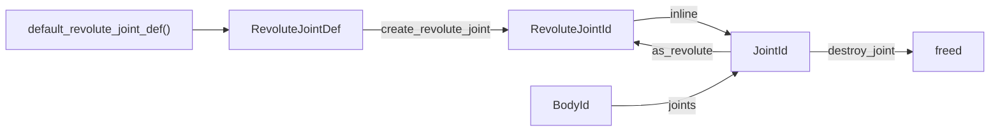

# Joints

[Documentation](../index.md) › [Public API](index.md) › Joints

Joints constrain the relative motion of two bodies. This page covers the shared definition base,
creation and validation, the accessors every joint has, narrowing a `JointId` to its typed handle,
and one section per joint type. Sources: `src/joint.c3i`, `src/joint.c3`, and the
`src/joint_<type>.c3i`/`.c3` pairs.



## Definitions

Every joint definition embeds a `JointDef` as `inline JointDef base`, so the base fields are
reached directly: `def.body_id_a`, `def.local_frame_a`, `def.collide_connected`.

| `JointDef` field | Default | Meaning |
|---|---|---|
| `body_id_a`, `body_id_b` | null | The two bodies. Both must belong to the world the joint is created in. |
| `local_frame_a`, `local_frame_b` | identity | The joint frame on each body, measured from the body origin, not its centre of mass. Recomputing mass leaves the anchor in place. |
| `collide_connected` | `false` | `false` suppresses collision between the two bodies. |
| `force_threshold`, `torque_threshold` | `float::max` | Joint-event thresholds. See [joint events](#joint-events). |
| `constraint_hertz`, `constraint_damping_ratio` | 60, 2 | Soft-constraint tuning. |
| `draw_scale` | `b3::length_units_per_meter()` | Debug-draw size. |
| `user_data` | null | Copied to the joint; read with `joint.user_data()`. |
| `internal_value` | cookie | Set by the default function. Do not write it. |

A definition must come from its type's `default_*_joint_def()`. Each default sets the cookie in
`internal_value`; a zeroed or hand-built struct is refused with `INVALID_DEFINITION`. The defaults
of the type-specific fields differ by type and are listed in each type's section.

## Creating joints

```c3
b3::RevoluteJointDef def = b3::default_revolute_joint_def();
def.body_id_a = ground;
def.body_id_b = arm;
def.local_frame_a.p = {0.0, 2.0, 0.0};
def.local_frame_b.p = {-1.0, 0.0, 0.0};
b3::RevoluteJointId hinge = b3::create_revolute_joint(world, &def)!;
```

| Type | Definition | Default | Constructor | Handle |
|---|---|---|---|---|
| filter | `FilterJointDef` | `default_filter_joint_def` | `create_filter_joint` | `JointId` |
| distance | `DistanceJointDef` | `default_distance_joint_def` | `create_distance_joint` | `DistanceJointId` |
| motor | `MotorJointDef` | `default_motor_joint_def` | `create_motor_joint` | `MotorJointId` |
| parallel | `ParallelJointDef` | `default_parallel_joint_def` | `create_parallel_joint` | `ParallelJointId` |
| prismatic | `PrismaticJointDef` | `default_prismatic_joint_def` | `create_prismatic_joint` | `PrismaticJointId` |
| revolute | `RevoluteJointDef` | `default_revolute_joint_def` | `create_revolute_joint` | `RevoluteJointId` |
| spherical | `SphericalJointDef` | `default_spherical_joint_def` | `create_spherical_joint` | `SphericalJointId` |
| weld | `WeldJointDef` | `default_weld_joint_def` | `create_weld_joint` | `WeldJointId` |
| wheel | `WheelJointDef` | `default_wheel_joint_def` | `create_wheel_joint` | `WheelJointId` |

Every constructor runs the same guard and returns the same faults:

| Fault | Cause |
|---|---|
| `INVALID_DEFINITION` | `def` is null; the world no longer exists; the definition did not come from a default function; a body id is null, stale, or belongs to another world. |
| `INVALID_HANDLE` | The world is locked: the call came from inside `world_step` or a callback it runs. |

The body check is not optional hardening: box3d writes through the body ids it is given, and its
own validation is compiled out of the release build. A disabled body is valid and can be jointed.

A joint between two non-dynamic bodies is accepted but never solved, and its
collision suppression has no effect, because two non-dynamic bodies never collide.

`b3::destroy_world` frees every joint in the world. `b3::destroy_joint(joint, wake_attached)`
removes one joint early; `wake_attached = true` wakes both bodies.

## The typed handles

Each typed handle (`RevoluteJointId`, `PrismaticJointId`, …) is a `typedef` declared
`inline JointId`. It converts to `JointId` implicitly, so every shared accessor below works on it
directly. The per-type accessors exist only on the typed handle.

A `JointId` from elsewhere (an event, `body.joints()`, user data) is narrowed with the matching
method:

```c3
b3::JointId[8] storage;
foreach (joint : arm.joints(storage[..])) {
    if (joint.type() != b3::JointType.REVOLUTE) continue;
    b3::RevoluteJointId hinge = joint.as_revolute()!;
    hinge.enable_spring(true);
    hinge.set_spring_hertz(1.0f);
}
```

`as_distance`, `as_motor`, `as_parallel`, `as_prismatic`, `as_revolute`, `as_spherical`,
`as_weld` and `as_wheel` each return:

| Fault | Cause |
|---|---|
| `INVALID_HANDLE` | The joint no longer exists. |
| `WRONG_JOINT_TYPE` | The joint is of another type. |

Do not cast a `JointId` to a typed handle with `(RevoluteJointId)joint`. box3d's own type check on
the per-type accessors is compiled out. A getter on the wrong type reads another type's solver
state; a setter overwrites it. A destroyed joint still reports its old `type()`, which is why the
narrowing checks liveness first. A filter joint has no per-type accessors and no typed handle.

## Shared accessors

All of these are methods on `JointId` unless written as a free function.

| Area | Symbols |
|---|---|
| Identity | `type()` → `JointType`, `world()`, `body_a()`, `body_b()` |
| Frames | `local_frame_a()`, `set_local_frame_a(t)`, `local_frame_b()`, `set_local_frame_b(t)` |
| Collision | `collide_connected()`, `set_collide_connected(bool)` |
| Tuning | `constraint_tuning()` → `ConstraintTuning { hertz, damping_ratio }`, `set_constraint_tuning(hertz, damping_ratio)` |
| Events | `force_threshold()`, `set_force_threshold(f)`, `torque_threshold()`, `set_torque_threshold(t)` |
| Reporting | `constraint_force()`, `constraint_torque()`, `linear_separation()`, `angular_separation()` |
| User data | `user_data()`, `set_user_data(p)` |
| Free functions | `b3::joint_wake_bodies(joint)`, `b3::destroy_joint(joint, wake_attached)` |
| On the body | `body.joint_count()`, `body.joints(buffer)` |

```c3
b3::ConstraintTuning tuning = joint.constraint_tuning();
joint.set_constraint_tuning(tuning.hertz * 0.5f, tuning.damping_ratio);
joint.set_force_threshold(1000.0f);
b3::joint_wake_bodies(joint);
```

`JointType` values: `PARALLEL`, `DISTANCE`, `FILTER`, `MOTOR`, `PRISMATIC`, `REVOLUTE`,
`SPHERICAL`, `WELD`, `WHEEL`, `MOVER`, `POGO`. No constructor for the last two is bound.

### Collision between the linked bodies

`collide_connected` controls the suppression, not the joint type. Suppression applies only while
at least one of the two bodies is dynamic.

- `set_collide_connected(true)` makes the two bodies collide from the next step.
- `set_collide_connected(false)` drops their contacts at once. A dropped contact whose shapes
  enabled contact events produces an end-touch event in the batch the next step fills.
- `destroy_joint` does not restore a suppressed collision. Two resting bodies stay apart until one
  of them moves. `set_collide_connected(true)` re-offers the pair to the broad phase;
  `destroy_joint` does not.

### Body joint list

`body.joint_count()` is exact. `body.joints(buffer)` returns the filled prefix of `buffer`, most
recently created joint first. A buffer of `joint_count()` entries is never truncated. Both work
while the world is locked.

### Joint events

A joint appears in `world.joint_events()` (see [Worlds and events](worlds.md)) on a step where its
reaction force reaches `force_threshold()` or its reaction torque reaches `torque_threshold()`.
Only awake joints are checked.

- The check runs only while at least one threshold is below `float::max`. The defaults keep both at
  `float::max`, so a default joint never reports.
- A threshold of 0 reports the joint on every awake step.
- The compared value is the solver's reaction force, not the value `constraint_force()` returns.

### Reporting accessors

`constraint_force()` (newtons), `constraint_torque()` (newton-metres), `linear_separation()` and
`angular_separation()` branch on the joint type. Read them against the type:

- A zero can mean the joint is unloaded, the type never measures that channel, or the type
  measures it only in some states. A filter joint reports zero on all four.
- `angular_separation()` is built from the two body rotations and ignores the local frames. It is
  always 0 on a wheel joint.
- On a prismatic joint, `linear_separation()` uses body A's axis, which differs from the axis
  `translation()` uses once `local_frame_a` is rotated.

Some types report wrong values through `constraint_force()` and `constraint_torque()`. Prefer the
per-type accessor where one exists:

| Type | Shared reading | Use instead |
|---|---|---|
| revolute | `constraint_torque()` counts the hinge-axis impulse twice. It also writes solver state as a side effect. | `motor_torque()` |
| prismatic | `constraint_force()` components are cyclically permuted, and an opposed limit and motor add instead of cancel. `constraint_torque()` is rotated twice; only its magnitude is right. | `motor_force()` |
| distance | `constraint_force()` sums each impulse once and is sound. | `motor_force()` for the motor share |
| motor | Both readings are sound. | none needed |
| spherical | `constraint_torque()` is wrong while a cone or twist limit is acting. | `motor_torque()` for the motor share |
| wheel | `constraint_force()` is permuted and mixes in a stored length. `constraint_torque()` lays the spin impulse on frame A's z axis instead of the wheel's spin axis. | `spin_torque()`, `steering_torque()`, with the caveats below |

## Filter joint

A filter joint constrains nothing. It exists to stop two bodies colliding, which it does through
`collide_connected = false`.

```c3
b3::FilterJointDef def = b3::default_filter_joint_def();
def.body_id_a = ground;
def.body_id_b = plate;
b3::JointId no_collide = b3::create_filter_joint(world, &def)!;
```

## Revolute joint

A hinge. The two local frames are held together and body B may turn about the frames' z axis, with
an optional spring, limit and motor.

```c3
b3::RevoluteJointDef def = b3::default_revolute_joint_def();
def.body_id_a = ground;
def.body_id_b = arm;
def.local_frame_a.p = {0.0, 2.0, 0.0};
def.local_frame_b.p = {-1.0, 0.0, 0.0};
def.enable_limit = true;
def.lower_angle = -0.25f * (float)math::PI;
def.upper_angle = 0.25f * (float)math::PI;
def.enable_motor = true;
def.motor_speed = 1.0f;
def.max_motor_torque = 500.0f;
b3::RevoluteJointId hinge = b3::create_revolute_joint(world, &def)!;

b3::world_step(world, 1.0f / 60.0f, 4);
float angle = hinge.angle();
float torque = hinge.motor_torque();
hinge.set_motor_speed(-1.0f);
hinge.set_limits(-0.5f, 0.5f);
```

Defaults: every field the definition adds is zero or false, so a default revolute joint is a bare
hinge. An enabled motor with `max_motor_torque` 0 turns nothing.

| Feature | Read | Write |
|---|---|---|
| angle | `angle()` | — |
| limit | `is_limit_enabled()`, `lower_limit()`, `upper_limit()` | `enable_limit(b)`, `set_limits(lower, upper)` |
| motor | `is_motor_enabled()`, `motor_speed()`, `max_motor_torque()`, `motor_torque()` | `enable_motor(b)`, `set_motor_speed(s)`, `set_max_motor_torque(t)` |
| spring | `is_spring_enabled()`, `spring_hertz()`, `spring_damping_ratio()`, `target_angle()` | `enable_spring(b)`, `set_spring_hertz(h)`, `set_spring_damping_ratio(r)`, `set_target_angle(a)` |

- `angle()` is the twist of frame B relative to frame A, in [-pi, pi]. It wraps, so a motor
  running for a long time reports a wrapped angle. It is not measured from `target_angle()`.
- Limits are swapped into order and clamped to [-0.99 pi, 0.99 pi], by the definition and by
  `set_limits`. Read them back to see what was stored.
- `target_angle` is clamped to [-pi, pi] on the definition path; `set_target_angle` stores its
  argument unclamped.
- Toggling `enable_limit`, `enable_motor` or `enable_spring` discards that feature's accumulated
  impulse.

## Prismatic joint

A slider. Body B translates along local frame A's x axis, with an optional spring, limit and motor.

```c3
b3::PrismaticJointDef def = b3::default_prismatic_joint_def();
def.body_id_a = ground;
def.body_id_b = slider;
def.local_frame_a.p = {0.0, 4.0, 0.0};
def.enable_spring = true;
def.hertz = 2.0f;
def.damping_ratio = 0.5f;
def.target_translation = 0.25f;
def.enable_limit = true;
def.lower_translation = -1.0f;
def.upper_translation = 1.0f;
b3::PrismaticJointId slide = b3::create_prismatic_joint(world, &def)!;

b3::world_step(world, 1.0f / 60.0f, 4);
float offset = slide.translation();
float rate = slide.speed();
slide.set_target_translation(-0.25f);
```

Defaults: every added field is zero or false.

| Feature | Read | Write |
|---|---|---|
| position | `translation()`, `speed()` | — |
| limit | `is_limit_enabled()`, `lower_limit()`, `upper_limit()` | `enable_limit(b)`, `set_limits(lower, upper)` |
| spring | `is_spring_enabled()`, `spring_hertz()`, `spring_damping_ratio()`, `target_translation()` | `enable_spring(b)`, `set_spring_hertz(h)`, `set_spring_damping_ratio(r)`, `set_target_translation(t)` |
| motor | `is_motor_enabled()`, `motor_speed()`, `max_motor_force()`, `motor_force()` | `enable_motor(b)`, `set_motor_speed(s)`, `set_max_motor_force(f)` |

- `translation()` is zero where the two frame origins coincide in world space.
- `set_limits` swaps a reversed pair into order and does not clamp. The definition stores
  `lower_translation` and `upper_translation` exactly as written, reversed or not.
- Toggling any enable flag discards that feature's accumulated impulse.

## Distance joint

Two anchors held at a rest length, with an optional spring, limit and motor.

```c3
b3::DistanceJointDef def = b3::default_distance_joint_def();
def.body_id_a = ground;
def.body_id_b = bob;
def.local_frame_a.p = {0.0, 6.0, 0.0};
def.length = 3.0f;
def.enable_spring = true;
def.hertz = 3.0f;
def.damping_ratio = 0.3f;
def.enable_limit = true;
def.min_length = 2.0f;
def.max_length = 4.0f;
b3::DistanceJointId rope = b3::create_distance_joint(world, &def)!;

b3::world_step(world, 1.0f / 60.0f, 4);
float rest = rope.length();
float now = rope.current_length();
```

Defaults: `length` 1, spring force range `-float::max` to `float::max`, `max_length` 1.0e5 length
units, other added fields zero or false.

| Feature | Read | Write |
|---|---|---|
| length | `length()`, `current_length()` | `set_length(l)` |
| limit | `is_limit_enabled()`, `min_length()`, `max_length()` | `enable_limit(b)`, `set_length_range(min, max)` |
| spring | `is_spring_enabled()`, `spring_hertz()`, `spring_damping_ratio()`, `spring_force_range()` → `SpringForceRange { lower, upper }` | `enable_spring(b)`, `set_spring_hertz(h)`, `set_spring_damping_ratio(r)`, `set_spring_force_range(lower, upper)` |
| motor | `is_motor_enabled()`, `motor_speed()`, `max_motor_force()`, `motor_force()` | `enable_motor(b)`, `set_motor_speed(s)`, `set_max_motor_force(f)` |

- The joint is rigid unless `enable_spring && (min_length < max_length || !enable_limit)`. Only
  then are the spring, limit and motor solved. Enabling the limit or motor on a joint whose spring
  is off changes nothing.
- An enabled spring with `hertz` 0 applies no spring force, but the joint still takes the sprung
  branch, so the limit and motor still act.
- `length()` is the rest length; `current_length()` is the anchors' current distance.
  `current_length()` returns 0 while the world is locked.
- `set_length` and `set_length_range` clamp to [0.005, 1.0e5] length units and zero the
  accumulated impulses. Construction only raises `length` and `min_length` to 0.005 length units
  and applies no ceiling.
- `set_spring_force_range` neither orders nor clamps its pair.

## Wheel joint

Body A is the chassis, body B the wheel. The wheel spins about local frame B's z axis. Suspension
travels along local frame A's x axis, and steering turns about that same axis.

```c3
b3::WheelJointDef def = b3::default_wheel_joint_def();
def.body_id_a = chassis;
def.body_id_b = wheel;
def.local_frame_a.p = {1.0, -1.0, 1.0};
def.local_frame_a.q = quaternion::from_axis_angle({0.0f, 0.0f, 1.0f}, 0.5f * (float)math::PI);
def.enable_spin_motor = true;
def.spin_speed = 10.0f;
def.max_spin_torque = 20.0f;
def.enable_suspension_limit = true;
def.lower_suspension_limit = -0.2f;
def.upper_suspension_limit = 0.2f;
b3::WheelJointId axle = b3::create_wheel_joint(world, &def)!;

axle.enable_steering(true);
axle.set_max_steering_torque(50.0f);
axle.set_target_steering_angle(0.3f);
```

The rotation turns frame A's x axis onto the chassis's y axis, so the suspension travels
vertically. `quaternion` is `std::math::quaternion`.

Defaults: `enable_suspension_spring` is true with hertz 1 and damping ratio 0.7, so a default wheel
is already sprung. The steering spring also defaults to hertz 1 and damping 0.7, but steering is
off. `max_steering_torque` and `max_spin_torque` default to 0.

| Feature | Read | Write |
|---|---|---|
| suspension spring | `is_suspension_enabled()`, `suspension_hertz()`, `suspension_damping_ratio()` | `enable_suspension(b)`, `set_suspension_hertz(h)`, `set_suspension_damping_ratio(r)` |
| suspension limit | `is_suspension_limit_enabled()`, `lower_suspension_limit()`, `upper_suspension_limit()` | `enable_suspension_limit(b)`, `set_suspension_limits(lower, upper)` |
| spin motor | `is_spin_motor_enabled()`, `spin_motor_speed()`, `max_spin_torque()`, `spin_speed()`, `spin_torque()` | `enable_spin_motor(b)`, `set_spin_motor_speed(s)`, `set_max_spin_torque(t)` |
| steering | `is_steering_enabled()`, `steering_hertz()`, `steering_damping_ratio()`, `max_steering_torque()`, `target_steering_angle()`, `steering_angle()`, `steering_torque()` | `enable_steering(b)`, `set_steering_hertz(h)`, `set_steering_damping_ratio(r)`, `set_max_steering_torque(t)`, `set_target_steering_angle(a)` |
| steering limit | `is_steering_limit_enabled()`, `lower_steering_limit()`, `upper_steering_limit()` | `enable_steering_limit(b)`, `set_steering_limits(lower, upper)` |

- `WheelJointDef.spin_speed` and `spin_motor_speed()` are the motor's target. `spin_speed()` is the
  wheel's measured rate.
- With steering off, box3d pins the steering angle at zero. The steering limit acts only while
  steering is enabled; the suspension limit acts whether or not the suspension spring is enabled.
- No wheel setter or definition field is ordered, clamped or validated. A reversed limit pair
  stays reversed.
- `spin_torque()` is a torque only while steering is enabled. With steering off it reports a
  correction term that scales with the torque ceiling and the sub-step count.
- `steering_torque()` excludes the steering limit. Its sign does not give the direction of travel
  once the spring saturates; take the direction from `steering_angle()`.

## Spherical joint

A ball and socket. Frame B's origin is pinned to frame A's; orientation is bounded by an optional
cone limit, twist limit, spring and motor.

```c3
b3::SphericalJointDef def = b3::default_spherical_joint_def();
def.body_id_a = ground;
def.body_id_b = plate;
def.local_frame_a.p = {-3.0, 3.0, 0.0};
def.local_frame_b.p = {0.0, 1.0, 0.0};
def.enable_cone_limit = true;
def.cone_angle = 0.4f;
def.enable_twist_limit = true;
def.lower_twist_angle = -0.2f;
def.upper_twist_angle = 0.2f;
b3::SphericalJointId ball = b3::create_spherical_joint(world, &def)!;
```

Defaults: every added field is zero or false except `target_rotation`, which is the identity.

| Feature | Read | Write |
|---|---|---|
| cone limit | `is_cone_limit_enabled()`, `cone_limit()`, `cone_angle()` | `enable_cone_limit(b)`, `set_cone_limit(a)` |
| twist limit | `is_twist_limit_enabled()`, `lower_twist_limit()`, `upper_twist_limit()`, `twist_angle()` | `enable_twist_limit(b)`, `set_twist_limits(lower, upper)` |
| spring | `is_spring_enabled()`, `spring_hertz()`, `spring_damping_ratio()`, `target_rotation()` | `enable_spring(b)`, `set_spring_hertz(h)`, `set_spring_damping_ratio(r)`, `set_target_rotation(q)` |
| motor | `is_motor_enabled()`, `motor_velocity()`, `max_motor_torque()`, `motor_torque()` → `Vec3` | `enable_motor(b)`, `set_motor_velocity(v)`, `set_max_motor_torque(t)` |

- `cone_angle()` and `twist_angle()` measure the frames' relative orientation, not position. A
  pendulum swinging on the joint reads 0 on both.
- The definition clamps `cone_angle` into [0, pi/2]; `set_cone_limit` stores its argument as given.
- The twist pair is ordered and clamped to [-0.99 pi, 0.99 pi] on both paths.
- `target_rotation` is not normalised. Pass a unit quaternion.
- `motor_velocity` is in world axes, not frame axes. A negative `max_motor_torque` reverses the
  motor rather than disabling it.

## Weld joint

Holds the two bodies at the relative transform the local frames describe, with one spring on
translation and one on rotation.

```c3
b3::WeldJointDef def = b3::default_weld_joint_def();
def.body_id_a = ground;
def.body_id_b = plate;
def.local_frame_a.p = {-3.0, 2.0, 0.0};
def.angular_hertz = 5.0f;
def.angular_damping_ratio = 0.7f;
b3::WeldJointId weld = b3::create_weld_joint(world, &def)!;
```

Defaults: all four added fields are 0.

| Feature | Read | Write |
|---|---|---|
| linear spring | `linear_hertz()`, `linear_damping_ratio()` | `set_linear_hertz(h)`, `set_linear_damping_ratio(r)` |
| angular spring | `angular_hertz()`, `angular_damping_ratio()` | `set_angular_hertz(h)`, `set_angular_damping_ratio(r)` |

- A hertz of 0 makes that channel rigid, not springless. Raising it makes the channel softer.
- A channel's damping ratio is read only while its hertz is non-zero. A rigid channel uses the
  joint's constraint tuning instead.

## Parallel joint

A spring that keeps frame A's z axis parallel to frame B's z axis and constrains nothing else. The
bodies stay free to translate and to spin about that axis. Use it to keep a body upright.

```c3
b3::ParallelJointDef def = b3::default_parallel_joint_def();
def.body_id_a = ground;
def.body_id_b = plate;
def.hertz = 2.0f;
def.max_torque = 200.0f;
b3::ParallelJointId upright = b3::create_parallel_joint(world, &def)!;
```

Defaults: `hertz` 1, `damping_ratio` 1, `max_torque` `float::max`. A default parallel joint is
already sprung.

| Feature | Read | Write |
|---|---|---|
| spring | `spring_hertz()`, `spring_damping_ratio()`, `max_torque()` | `set_spring_hertz(h)`, `set_spring_damping_ratio(r)`, `set_max_torque(t)` |

- A hertz of 0 or a `max_torque` of 0 stops the spring, the opposite of the weld joint's 0.
- A spring silenced after it has worked keeps re-applying its last impulse. Silence it before the
  first step to get a free joint.

## Motor joint

Drives body B toward a relative linear and angular velocity, and pulls it toward the transform the
two local frames describe with a linear and an angular spring.

```c3
b3::MotorJointDef def = b3::default_motor_joint_def();
def.body_id_a = ground;
def.body_id_b = plate;
def.linear_velocity = {1.0, 0.0, 0.0};
def.max_velocity_force = 100.0f;
def.angular_hertz = 4.0f;
def.max_spring_torque = 50.0f;
b3::MotorJointId drive = b3::create_motor_joint(world, &def)!;

drive.set_linear_velocity({0.0, 0.0, 1.0});
```

Defaults: every added field is zero, so a default motor joint applies nothing.

| Channel | Read | Write | Solved while |
|---|---|---|---|
| linear drive | `linear_velocity()`, `max_velocity_force()` | `set_linear_velocity(v)`, `set_max_velocity_force(f)` | `max_velocity_force > 0` |
| angular drive | `angular_velocity()`, `max_velocity_torque()` | `set_angular_velocity(v)`, `set_max_velocity_torque(t)` | `max_velocity_torque > 0` |
| linear spring | `linear_hertz()`, `linear_damping_ratio()`, `max_spring_force()` | `set_linear_hertz(h)`, `set_linear_damping_ratio(r)`, `set_max_spring_force(f)` | hertz and ceiling both > 0 |
| angular spring | `angular_hertz()`, `angular_damping_ratio()`, `max_spring_torque()` | `set_angular_hertz(h)`, `set_angular_damping_ratio(r)`, `set_max_spring_torque(t)` | hertz and ceiling both > 0 |

- The type has no enable flags. A ceiling of 0 turns its channel off.
- The target velocities are in world axes, not frame axes.
- Dropping a ceiling to 0 after the channel has worked does not remove the impulse it holds.
- There is no per-type force or torque getter. `constraint_force()` and `constraint_torque()` are
  sound on this type.

## Contracts

- Definitions come from the type's `default_*_joint_def()`. A zeroed definition returns
  `INVALID_DEFINITION`.
- Both bodies must be live bodies of the world passed to the constructor.
- Constructors return `INVALID_HANDLE` while the world is locked. `set_collide_connected` and
  `joint_wake_bodies` silently do nothing while it is locked. `destroy_joint` and the other shared
  accessors have no locked-world check.
- Narrow with `as_<type>()`, never with a cast. A per-type accessor called on the wrong joint type
  corrupts that joint's state.
- Check a stored `JointId` with `joint.is_valid()` before use. A joint in `world.joint_events()` may
  already be destroyed.
- Many setters assert their argument in box3d's debug build, and those assertions are compiled out
  of the release build this package links. Negative stiffness, non-finite values and reversed
  ranges are stored unless the type's section says it corrects them.
- Destroying a joint does not restore collision between two resting bodies. Use
  `set_collide_connected(true)`.
- `constraint_force()` and `constraint_torque()` are type-dependent and wrong on several types. Use
  the per-type reading listed in [Reporting accessors](#reporting-accessors).
- Docstrings in `src/joint*.c3i` give the exact contract of each setter, including which ones
  discard accumulated impulses.
