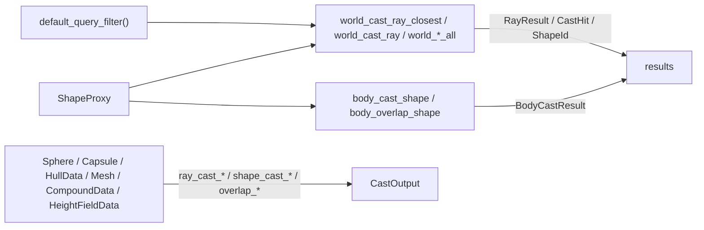

# Queries and casts

[Documentation](../index.md) › [Public API](index.md) › Queries and casts

Ray casts, shape casts and overlap tests against a world, a single body, a single shape, or raw
geometry with no world at all, plus the accessors that read a body's contacts, shapes and sensor
overlaps. Sources: `src/query.c3i`, `src/query.c3`, `src/cast.c3i`, `src/cast.c3`.



| Scope | Functions | Shapes considered |
|---|---|---|
| World | `world_cast_ray_closest`, `world_cast_ray`, `world_cast_ray_all`, `world_cast_shape`, `world_cast_shape_all`, `world_overlap_aabb`, `world_overlap_aabb_all`, `world_overlap_shape`, `world_overlap_shape_all` | every shape passing the filter, through the broad phase |
| Body | `body_cast_ray`, `body_cast_shape`, `body_overlap_shape` | the body's shapes, at a transform the caller supplies |
| Body | `body.closest_point()` | the body's shapes, at the body's current pose |
| Shape | `shape_ray_cast` | one shape at its current transform |
| Geometry | `ray_cast_*`, `shape_cast_*`, `overlap_*` | one geometry value in its own frame; no world needed |

## Query filters

```c3
b3::QueryFilter filter = b3::default_query_filter();
filter.mask_bits = LAYER_DEBRIS;
```

A shape is considered when the filter's `mask_bits` overlap the shape's `category_bits` and the
shape's `mask_bits` overlap the filter's `category_bits`. `default_query_filter()` sets every bit in
both, so an unmodified filter considers every shape. `id` and `name` label the query in a
[recording](recording.md) and are ignored otherwise; a non-null `name` must outlive the query.

## Closest ray hit

```c3
b3::QueryFilter filter = b3::default_query_filter();
if (try hit = b3::world_cast_ray_closest(
  world: world,
  origin: {0.0, 4.0, 0.0},
  translation: {0.0, -8.0, 0.0},
  filter: filter,
)) {
    b3::Pos impact = hit.point;
}
```

The ray runs from `origin` to `origin + translation`. `RayResult.fraction` is a fraction of
`translation`, not a distance. A ray that starts inside a shape does not report that shape.
A miss returns `NO_HIT`. `RayResult` also carries `shape_id`, `normal`, `user_material_id`,
`triangle_index`, `child_index`, and the diagnostic counters `node_visits` and `leaf_visits`.

## Callback casts

```c3
struct NearestHit {
    b3::ShapeId shape;
    float fraction;
    bool found;
}

fn float nearest_hit(
  b3::ShapeId shape_id,
  b3::Pos point,
  b3::Vec3 normal,
  float fraction,
  ulong user_material_id,
  int triangle_index,
  int child_index,
  void* context,
) {
    NearestHit* nearest = (NearestHit*)context;
    nearest.shape = shape_id;
    nearest.fraction = fraction;
    nearest.found = true;
    return fraction;
}

fn void callback_example(b3::WorldId world) {
    NearestHit nearest;
    b3::TreeStats stats = b3::world_cast_ray(
      world: world,
      origin: {0.0, 4.0, 0.0},
      translation: {0.0, -12.0, 0.0},
      filter: b3::default_query_filter(),
      fcn: &nearest_hit,
      context: &nearest,
    );
}
```

`world_cast_ray` calls a `CastResultFn` once per shape along the ray, in no particular order. The
return value steers the cast:

| Return | Effect |
|---|---|
| `-1` | Ignore this shape and continue. |
| `0` | End the cast. |
| `1` | Continue without clipping. |
| between 0 and 1 | Clip the ray at that fraction; later shapes are reported only if nearer. |

Returning `fraction` therefore converges on the closest hit. `world_cast_shape` takes the same
callback type. `world_overlap_aabb` and `world_overlap_shape` take an `OverlapResultFn`,
`fn bool(ShapeId shape_id, void* context)`; returning `false` ends the query.

The four callback functions return `TreeStats { node_visits, leaf_visits }`, broad-phase traversal
counters for diagnostics.

### What a callback may do

- Callbacks run synchronously on the thread that called the query, before the query returns.
  The query enqueues no task.
- A callback may read world, body and shape state, write into its `context`, and steer the query
  through its return value.
- A callback must not modify the world: no creating, destroying or moving bodies, shapes or joints.
- The callback signatures are not optional types. A callback cannot return a fault; record a
  failure in `context` and end the query.

## Collecting casts and overlaps

```c3
b3::CastHit[16] storage;
b3::CastHit[] hits = b3::world_cast_ray_all(
  world: world,
  origin: {0.0, 4.0, 0.0},
  translation: {0.0, -12.0, 0.0},
  filter: b3::default_query_filter(),
  buffer: storage[..],
);
foreach (hit : hits) io::printfn("collected fraction %f", hit.fraction);
```

The `_all` variants collect into a caller-supplied buffer and return its filled prefix:

| Function | Element | Collects |
|---|---|---|
| `world_cast_ray_all` | `CastHit` | every shape along the ray, unclipped, in no particular order |
| `world_cast_shape_all` | `CastHit` | every shape the swept proxy reaches |
| `world_overlap_aabb_all` | `ShapeId` | every shape whose broad-phase bounds overlap the box |
| `world_overlap_shape_all` | `ShapeId` | every shape overlapping the proxy |

Nothing is allocated. The query ends when the buffer is full, so a result as long as the buffer may
mean more shapes were there. `CastHit` holds what the cast callback receives: `shape_id`, `point`,
`normal`, `fraction`, `user_material_id`, `triangle_index`, `child_index`.

## Shape proxies

A `ShapeProxy` is a convex point cloud with a radius, used as the swept shape of a shape cast and
the probe of a shape overlap. A single point with a radius is a sphere.

```c3
b3::Vec3[1] points = { {0.0, 0.0, 0.0} };
b3::ShapeProxy probe = { .points = &points, .count = 1, .radius = 0.25 };

b3::CastHit[8] hit_storage;
b3::CastHit[] swept = b3::world_cast_shape_all(
  world: world,
  origin: {0.0, 4.0, 0.0},
  proxy: &probe,
  translation: {0.0, -8.0, 0.0},
  filter: b3::default_query_filter(),
  buffer: hit_storage[..],
);

b3::ShapeId[8] overlap_storage;
b3::ShapeId[] touching = b3::world_overlap_shape_all(
  world: world,
  origin: {0.0, -2.5, 0.0},
  proxy: &probe,
  filter: b3::default_query_filter(),
  buffer: overlap_storage[..],
);
```

- The points are borrowed. box3d reads them during the call and does not copy them. A stack array
  that outlives the call is fine.
- The world and body functions place the proxy's points relative to `origin`.
- A proxy must have a non-null `points`, and `count` between 1 and `MAX_SHAPE_CAST_POINTS` (128).
  The [geometry casts](#geometry-casts) check this and return `INVALID_DEFINITION`. The world and
  body functions pass the proxy to box3d unchecked; keeping it in bounds is the caller's job there.
- A shape cast's fraction includes box3d's linear slop. It stops at a core separation of
  `max(slop, total_radius - slop)`, so the reported fraction lands slightly short of geometric
  contact for a total radius below one slop, and past it above. Ray-cast fractions are exact.

## Overlaps

`world_overlap_aabb` reports shapes whose broad-phase bounds overlap the box. It is not an exact
test against shape geometry.

```c3
fn bool count_overlap(b3::ShapeId shape_id, void* context) {
    int* count = (int*)context;
    (*count)++;
    return true;
}

fn void aabb_example(b3::WorldId world) {
    b3::Aabb box = { .lower_bound = {-1.0, -5.0, -1.0}, .upper_bound = {1.0, 1.0, 1.0} };
    int count;
    b3::world_overlap_aabb(
      world: world,
      aabb: box,
      filter: b3::default_query_filter(),
      fcn: &count_overlap,
      context: &count,
    );
}
```

`world_overlap_shape` and `world_overlap_shape_all` test the proxy against shape geometry.

## Body and shape queries

```c3
b3::WorldTransform predicted = ground.transform();
predicted.p.x += 0.5f;
if (try hit = b3::body_cast_ray(
  body: ground,
  origin: {0.5, 4.0, 0.0},
  translation: {0.0, -8.0, 0.0},
  filter: b3::default_query_filter(),
  max_fraction: 1.0f,
  body_transform: predicted,
)) {
    io::printfn("body ray fraction %f", hit.fraction);
}

b3::ClosestPoint nearest = ground.closest_point({0.0, 4.0, 0.0});
```

| Function | Returns | Faults |
|---|---|---|
| `body_cast_ray(body, origin, translation, filter, max_fraction, body_transform)` | `BodyCastResult` | `NO_HIT`; `INVALID_DEFINITION` when `max_fraction > 1` |
| `body_cast_shape(body, origin, proxy, translation, filter, max_fraction, can_encroach, body_transform)` | `BodyCastResult` | `NO_HIT`; `INVALID_DEFINITION` when `max_fraction > 1` |
| `body_overlap_shape(body, origin, proxy, filter, body_transform)` | `bool` | none |
| `body.closest_point(target)` | `ClosestPoint { point, distance }` | none |
| `shape_ray_cast(shape, origin, translation)` | `WorldCastOutput` | `NO_HIT` |

- The body functions test the body's shapes at `body_transform`, which need not be the body's
  current transform. Passing a predicted transform casts against a future pose.
- `max_fraction` above 1 is refused because a mesh or height field shape would report a miss as a
  hit at exactly 1.
- `body_overlap_shape` is a direct binding and returns `false` both for no overlap and for a
  locked world. It shares the compound miss of `world_overlap_shape`.
- `closest_point` measures to shape cores with radii excluded. For a sphere or capsule the point is
  on the centre or centre line, and the distance exceeds the surface gap by the radius. Only
  spheres, capsules and hulls are considered. A body with none of them reports its own origin at
  distance `float::max`.
- `shape_ray_cast` tests one shape at its current transform and skips the broad phase.
  `WorldCastOutput` is an alias of `CastOutput` in this float build.

## Geometry casts

These work on geometry values in their own frame and need no world. The geometry types come from
[Shapes](shapes.md).

```c3
b3::Sphere sphere = { .center = {0.0, 0.0, 0.0}, .radius = 0.5 };
b3::RayCastInput ray = {
    .origin = {0.0, 4.0, 0.0},
    .translation = {0.0, -8.0, 0.0},
    .max_fraction = 1.0,
};
b3::CastOutput hit = b3::ray_cast_sphere(&sphere, ray)!;

b3::Vec3[1] points = { {0.0, 0.0, 0.0} };
b3::ShapeProxy probe = { .points = &points, .count = 1, .radius = 0.25 };
b3::Transform placement = { .p = {0.0, 0.6, 0.0}, .q = { .i = 0.0, .j = 0.0, .k = 0.0, .l = 1.0 } };
bool touching = b3::overlap_sphere(&sphere, placement, probe)!;

b3::Vec3[1] start = { {0.0, 4.0, 0.0} };
b3::ShapeCastInput sweep = {
    .proxy = { .points = &start, .count = 1, .radius = 0.25 },
    .translation = {0.0, -8.0, 0.0},
    .max_fraction = 1.0,
    .can_encroach = false,
};
float sweep_fraction = b3::shape_cast_sphere(&sphere, sweep)!.fraction;
```

`RayCastInput { origin, translation, max_fraction }` and
`ShapeCastInput { proxy, translation, max_fraction, can_encroach }` are expressed in the geometry's
frame. `ray.is_valid()` checks that every component is finite and `max_fraction` is non-negative
and bounded. It says nothing about whether the ray reaches anything. box3d's own check of it is
compiled out.

| Geometry | Ray cast | Shape cast | Overlap |
|---|---|---|---|
| `Sphere*` | `ray_cast_sphere`, `ray_cast_hollow_sphere` | `shape_cast_sphere` | `overlap_sphere` |
| `Capsule*` | `ray_cast_capsule` | `shape_cast_capsule` | `overlap_capsule` |
| `HullData*` | `ray_cast_hull` | `shape_cast_hull` | `overlap_hull` |
| `CompoundData*` | `ray_cast_compound` | `shape_cast_compound` | `overlap_compound` |
| `Mesh*` | `ray_cast_mesh` | `shape_cast_mesh` | `overlap_mesh` |
| `HeightFieldData*` | `ray_cast_height_field` | `shape_cast_height_field` | `overlap_height_field` |

Ray and shape casts return `CastOutput` or `NO_HIT`. Overlaps return `bool?`. Every shape cast and
overlap runs `check_shape_proxy` first: a null `points`, `count < 1`, or
`count > MAX_SHAPE_CAST_POINTS` returns `INVALID_DEFINITION`.

Per-function contracts:

- **Starting inside.** A ray starting inside a solid sphere, capsule, hull or compound child reports
  fraction 0 with a zero normal. Normalising that normal yields NaN. A shape cast starting in
  contact reports the same unless `can_encroach` is set and the cores start apart.
- **`ray_cast_hollow_sphere`** tests the surface only. Its fraction is a distance in the sphere's
  units, not a fraction of `translation`, and `max_fraction` bounds that distance. A unit-length
  `translation` makes the two agree.
- **`max_fraction > 1`** returns `INVALID_DEFINITION` from `ray_cast_compound`, `ray_cast_mesh`,
  `ray_cast_height_field`, and from `shape_cast_height_field` with a one-point, zero-radius proxy.
  box3d's triangle solver reports a miss as a hit at 1.
- **Meshes.** Mesh ray casts and shape casts reach a triangle only from its wound side; a shape
  cast skips a triangle whose plane has the proxy's centre behind it. Overlaps are two-sided.
- **Height fields.** Nothing is reported from underneath or over a hole cell. The surface sits up
  to one 16-bit quantisation step below the source heights.
- **Overlaps** treat a gap under a tenth of a linear slop as touching. The proxy is read in the
  frame `transform` places the geometry into.
- **`CastOutput`** reports `child_index` and `material_index` for compounds. A single-shape cast
  leaves `material_index` at -1 where the shape has no material.

## Contacts and attached lists

```c3
b3::ContactData[16] storage;
foreach (contact : ball.contact_data(storage[..])) {
    foreach (&manifold : contact.contact_manifolds()) {
        foreach (point : manifold.contact_points()) {
            io::printfn("separation %f impulse %f", point.separation, point.total_normal_impulse);
        }
    }
}
```

| Accessor | Returns | Sizing |
|---|---|---|
| `body.contact_data(buffer)` | `ContactData[]`, touching contacts only | `body.contact_capacity()`, an upper bound |
| `shape.contact_data(buffer)` | `ContactData[]` involving the shape; none for a sensor | `shape.contact_capacity()`, the whole body's count |
| `contact_id.data()` | `ContactData` | — |
| `body.shapes(buffer)` | `ShapeId[]` | `body.shape_count()`, exact |
| `shape.sensor_data(buffer)` | `ShapeId[]` overlapping a sensor | `shape.sensor_capacity()`, exact |

Each filler writes into the caller's buffer and returns the filled prefix. The joint list,
`body.joints(buffer)`, is on the [Joints](joints.md#body-joint-list) page.

- `ContactData { contact_id, shape_id_a, shape_id_b, manifolds, manifold_count }`. Read the
  manifolds through `contact.contact_manifolds()`, which returns a `Manifold[]` borrowing box3d's
  memory. The next step recomputes it and `destroy_world` frees it. Copy out anything that must
  outlive either; keep the `ContactId` and call `data()` again.
- `Manifold` holds up to `MAX_MANIFOLD_POINTS` (4) points, a unit `normal` from shape A to shape B,
  and friction, twist and rolling impulses. `manifold.contact_points()` returns the valid
  `point_count` prefix. Iterate with `foreach (&manifold : ...)` so the slice points into box3d's
  manifold rather than a loop copy.
- `ManifoldPoint` may be speculative. `separation` is negative only when the shapes overlap, and
  `total_normal_impulse` shows whether the point carried any load.
- The contact and sensor capacities and fillers return 0 while the world is locked.
  `shape_count()` and `shapes()` keep working.
- A sensor overlap may name a shape destroyed since; check `shape.is_valid()` before using it.
- `contact_id.data()` does not validate its id; box3d's generation check is compiled out. Check
  `contact_id.is_valid()` on a stored id first.

## Contracts

- A miss is the fault `NO_HIT`, never a result with `hit == false`.
- World queries, body queries and `closest_point` return nothing while the world is locked: world
  callbacks are not called, `TreeStats` is zero, `world_cast_ray_closest` and the body casts return
  `NO_HIT`, `body_overlap_shape` returns `false`, and `closest_point` returns the zero vector at
  distance 0. A query made from inside a step callback therefore finds nothing.
- Callbacks run on the calling thread during the query and must not modify the world.
- Proxy points are borrowed for the call. World and body functions do not validate the proxy;
  geometry functions return `INVALID_DEFINITION` for a null array or a count outside
  1..`MAX_SHAPE_CAST_POINTS`.
- `world_overlap_aabb` tests broad-phase bounds, not geometry.
- Shape-cast fractions carry linear slop; compare them with a tolerance.
- `body_cast_ray`, `body_cast_shape`, `ray_cast_compound`, `ray_cast_mesh` and
  `ray_cast_height_field` refuse `max_fraction > 1`.
- Contact manifolds borrow world memory until the next step.
- Capacities from `contact_capacity()` are upper bounds; a full buffer may mean truncation.
