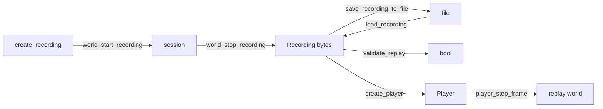

# Recording and replay

[Documentation](../index.md) › [Public API](index.md) › Recording and replay

Recording a world's mutations into a byte buffer, saving and loading it, checking that it replays
deterministically, and stepping through it with a player for inspection. Everything here is in
module `b3::record`, reached by `import b3;`. Faults are `b3::` faults.



## Record a session

```c3
record::Recording* recording = record::create_recording(0);   // 64 KiB start, grows
defer record::destroy_recording(recording);

record::world_start_recording(world, recording)!;
make_ball(world, 4.0f)!;                                      // mutations after start are recorded
for (int i = 0; i < 120; i++) {
    b3::world_step(world, 1.0f / 60.0f, 4);
}
record::world_stop_recording(world);
```

`create_recording(byte_capacity)` creates a buffer the caller owns. A capacity of 0 or below
starts at 64 KiB. The buffer grows as needed, so the capacity is a starting size, not a limit.
`destroy_recording` frees it; call it exactly once. A live recording counts toward
[`b3::byte_count()`](library_and_math.md#allocator).

`world_start_recording(world, recording)` resets the buffer and starts a session. The session
captures the world's current state, then every mutation and step until `world_stop_recording`.
box3d refuses silently for a null buffer, a locked world, or a world already recording. The
wrapper detects a refusal by the buffer still being empty after the call and returns
`NOT_A_RECORDING`. A refusal on a buffer that already holds bytes (the one this world is recording
into, or one loaded from a file) is not detected.

`world_stop_recording(world)` writes the trailing data that makes the buffer self-contained. It
does nothing on a world that is not recording. `b3::destroy_world` stops a recording itself.

`recording.data()` returns the bytes recorded so far. The slice borrows box3d's buffer, which
moves as it grows: any recorded step invalidates earlier slices, and so does
`destroy_recording`.

## Files and validation

```c3
record::save_recording_to_file(recording, "scene.b3rec")!;
record::Recording* loaded = record::load_recording("scene.b3rec")!;
defer record::destroy_recording(loaded);
bool deterministic = record::validate_replay(loaded.data(), 1);
```

`save_recording_to_file` overwrites the path and returns `FILE_UNAVAILABLE` when the file cannot
be opened or fully written. A buffer no session has written saves as an empty file that
`load_recording` then refuses.

`load_recording` returns a new `Recording` the caller destroys, or `FILE_UNAVAILABLE` when the
path cannot be read or holds no recording.

`validate_replay(data, worker_count)` replays the bytes in a private world and checks every state
hash they carry. It returns true only when all match. False covers both divergence and bytes that
are not a recording. It creates and destroys its world itself.

## Replay with a player

```c3
record::Player* player = record::create_player(recording.data(), 1)!;
defer record::destroy_player(player);

record::PlayerInfo info = player.info();
while (record::player_step_frame(player)) {
    draw::world_draw(player.world_id(), &debug, ulong::max);
    for (int i = 0; i < player.frame_query_count(); i++) {
        record::QueryInfo query = player.frame_query(i)!;
    }
}
if (record::player_has_diverged(player)) {
    io::printfn("diverged at frame %d", player.diverge_frame()!);
}
```

`create_player(data, worker_count)` copies the bytes (the slice need not outlive the call) and
stands up a private replay world. It returns `NOT_A_RECORDING` when the bytes carry no replayable
header; box3d also prints the reason to standard output. `destroy_player` frees the player, its
world and its copy of the bytes; call it exactly once.

`player.info()` returns a `PlayerInfo`: `frame_count`, the player's `worker_count`, the recorded
`time_step`, `sub_step_count` and `length_scale`, and `bounds` covering the whole recording.

| Call | Effect |
|---|---|
| `player_step_frame(player)` | replays up to and including the next step; false once the recording is exhausted |
| `player_sub_step_frame(player)` | like `step_frame`, but stops once between a frame's body creations and its step |
| `player_seek_frame(player, frame)` | replays to `frame`; a backward seek restores the nearest earlier keyframe; out-of-range targets clamp |
| `player_restart(player)` | rewinds to frame 0 and clears the divergence state |
| `player_has_diverged(player)` | true once a frame failed to reproduce its state hash or a recorded query result |
| `player.diverge_frame()` | the first diverging frame, or `NO_HIT` when none has |
| `player.frame()` | the last fully replayed frame: 0 before the first step, `frame_count()` at the end |
| `player.frame_count()`, `player.is_at_end()` | length and end state |
| `player.is_at_pre_step()` | true while `sub_step_frame` is paused before a frame's step |
| `player.world_id()` | the replay world, for drawing and reading bodies |

### Bodies

```c3
record::player_seek_frame(player, 30);
b3::BodyId first = player.body_id(0)!;      // creation ordinal 0, if still alive
b3::Pos where = first.position();
record::player_restart(player);             // frame 0, same world_id()
```

`player.body_count()` counts every body created so far in the replay, destroyed ones included.
`player.body_id(ordinal)` returns the live body at a creation ordinal: `INDEX_OUT_OF_RANGE` outside
`0..body_count() - 1`, `INVALID_HANDLE` when that body has been destroyed.

### Recorded queries

Spatial queries made on a recorded world (overlaps, ray and shape casts, mover casts) are recorded
and re-issued during replay. A query belongs to the frame whose step follows it.

- `player.frame_query_count()` is the number re-issued by the last replayed frame.
- `player.frame_query(i)` returns a `QueryInfo`: the `QueryType`, filter, box, origin,
  translation, `hit_count`, and the filter's tag (`key`, `id`, `name`). `name` borrows the
  player's storage. `INDEX_OUT_OF_RANGE` outside the count.
- `player.frame_query_hit(query, hit)` returns a `QueryHit`: the shape, and for `CAST_RAY`,
  `CAST_SHAPE` and `CAST_RAY_CLOSEST` the point, normal and fraction. For the other types those
  three fields are leftover data, not results. `INDEX_OUT_OF_RANGE` outside either count.

### Draw a replay

```c3
player.set_worker_count(4);                          // replay across four workers
player.set_keyframe_policy(64 * 1024 * 1024, 8);     // 64 MiB ring, a keyframe every 8+ frames
while (!player.is_at_end()) {
    record::player_sub_step_frame(player);
    if (player.is_at_pre_step()) continue;           // new bodies at their creation pose
    record::player_draw_frame_queries(
      player: player,
      draw: &debug,
      query_index: -1,
      selected_index: -1,
    );
}
```

`draw::world_draw(player.world_id(), ...)` draws the replay world like any other; see
[debug draw](debug_draw.md). `player_draw_frame_queries(player, draw, query_index,
selected_index)` overlays the last frame's queries: casts as segments with hit points and
normals, movers and cast proxies as capsules and spheres, overlaps as boxes. A negative
`query_index` draws all; `selected_index` draws one in a highlight colour. It ignores the
`DebugDraw` flags and skips null callbacks.

`player.set_debug_shape_callbacks(create, destroy, context)` installs
[shape-handle callbacks](debug_draw.md#shape-handles) on the replay world. It replaces the replay
world with a new one and rewinds to frame 0, so call it right after `create_player`. The old
`world_id()` is invalid afterwards.

### Tuning

- `player.set_worker_count(n)` sets the replay world's worker count, clamped to
  `1..b3::MAX_WORKERS`. A recording does not store the count it was made with. Replaying at a
  different count turns the hash check into a cross-thread determinism test.
- `player.set_keyframe_policy(budget_bytes, min_interval_frames)` sizes the keyframe ring that
  backward seeks restore from. A budget of 0 or an interval below 1 keeps the current value. The
  ring is cleared either way. `keyframe_budget()` and `keyframe_min_interval()` read the policy;
  `keyframe_interval()` is the spacing in use, which doubles when the ring evicts to stay in
  budget; `keyframe_bytes()` is the memory in use.

## Contracts

- `Recording` and `Player` are caller-owned. Destroy each exactly once. Both count toward
  `b3::byte_count()`.
- A live player owns a world. It counts toward `b3::world_count()` and `MAX_WORLDS`.
- `recording.data()` slices are invalidated by the next recorded mutation or step and by
  `destroy_recording`.
- `world_start_recording` detects a refusal only on an empty buffer.
- A live player sets the process-wide [length unit](library_and_math.md#length-units) to the
  recording's and restores the previous value on `destroy_player`. `create_player` or
  `validate_replay` on bytes rejected after the header leaves the recording's unit in place.
- `set_debug_shape_callbacks` replaces the replay world; re-read `world_id()` after it.
- `QueryHit.point`, `normal` and `fraction` are meaningful only for the three cast types.
