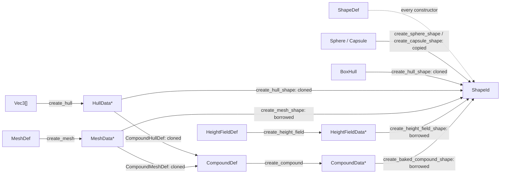

# Shapes

[Documentation](../index.md) › [Public API](index.md) › Shapes

Shape definitions, the seven shape constructors, the geometry behind them (spheres, capsules,
hulls, meshes, height fields, compounds), mass and bounds, and the per-shape accessors. Sources:
`src/shape.c3i`, `src/hull.c3i`, `src/mesh.c3i`, `src/compound.c3i` and their wrappers.

A shape attaches geometry to a body. What the shape does with the geometry depends on its kind:
spheres, capsules and hulls are copied into the world, while meshes, height fields and compounds
are borrowed and must outlive every shape built on them.



## Shape definitions

```c3
b3::ShapeDef def = b3::default_shape_def();
def.density = 500.0f;
def.base_material.friction = 0.4f;
def.base_material.restitution = 0.2f;
def.filter.category_bits = PLAYER;
def.filter.mask_bits = STATIC | ENEMY;
def.enable_contact_events = true;

b3::Sphere ball = { .center = { 0, 0.5f, 0 }, .radius = 0.5f };
b3::ShapeId shape = b3::create_sphere_shape(body, &def, &ball)!;
defer b3::destroy_shape(shape, true);
```

A `ShapeDef` must start from `b3::default_shape_def()`. Every shape constructor checks the
definition's internal marker and returns `INVALID_DEFINITION` for a null definition or one built
any other way. The constructor copies the definition, so it need not outlive the call.

`default_shape_def()` sets a density of 1000 / length-units³ (water), `explosion_scale` 1, the
default filter, `update_body_mass`, `invoke_contact_creation` and `enable_speculative_contact`.
Every event flag starts off, sensor events included.

| Field | Meaning |
|---|---|
| `name`, `user_data` | debugging name (the world interns a copy) and an application pointer |
| `base_material` | the shape's `SurfaceMaterial`; ignored for compounds |
| `materials`, `material_count` | per-triangle materials for a mesh shape; copied at creation |
| `density` | mass per volume; meshes, height fields and compounds contribute no mass |
| `explosion_scale` | multiplier on the impulse `b3::world_explode` applies |
| `filter`, `enable_custom_filtering` | collision filter; custom filtering needs one shape of a pair |
| `is_sensor` | detects overlaps, never collides; see [Sensors](#sensors) |
| `enable_*_events` | sensor, contact, hit and pre-solve events; see [Events](#events) |
| `update_body_mass` | recompute the body's mass after this shape is added |

`b3::default_surface_material()` returns friction 0.6 and every other field zero.
`SurfaceMaterial` also carries `rolling_resistance` (spheres and capsules only),
`tangent_velocity` (conveyor belts), `user_material_id` (reported by queries and to the friction
and restitution callbacks) and `custom_color` (debug draw).

`b3::default_filter()` sets every bit of `category_bits` and `mask_bits` and a `group_index` of
0. Two shapes collide when each one's mask overlaps the other's category. A shared non-zero
`group_index` overrides the bits: positive always collides, negative never does.

## Spheres, capsules and hulls

```c3
b3::Sphere ball = { .center = { 0, 0.5f, 0 }, .radius = 0.5f };
b3::ShapeId ball_shape = b3::create_sphere_shape(body, &def, &ball)!;

b3::Capsule pill = { .center1 = { 0, 0.25f, 0 }, .center2 = { 0, 1.25f, 0 }, .radius = 0.25f };
b3::ShapeId pill_shape = b3::create_capsule_shape(body, &def, &pill)!;

b3::BoxHull box = b3::make_box_hull(1.0f, 0.5f, 2.0f);
b3::ShapeId box_shape = b3::create_hull_shape(body, &def, &box.base)!;

b3::ShapeId wedge = b3::create_transformed_hull_shape(
  body: body,
  def: &def,
  hull: &box.base,
  transform: { .p = { 0, 2, 0 }, .q = { .v = { 0, 0, 0, 1 } } },
  scale: { 1, 0.5f, -1 },
)!;
```

Geometry is given in body-local space. `b3::create_sphere_shape`, `b3::create_capsule_shape`,
`b3::create_hull_shape` and `b3::create_transformed_hull_shape` copy or clone what they are
handed, so a stack value is enough. Each returns `INVALID_DEFINITION` for a null geometry pointer
and `INVALID_HANDLE` when box3d returns a null identifier, which includes a call made while the
world is locked.

- A capsule whose two centres lie within one linear slop (5 mm at unit length scale) becomes a
  sphere: check `shape.type()` rather than assuming `CAPSULE`.
- `create_transformed_hull_shape` bakes a scale, then a transform, into its clone. The scale may
  be non-uniform or mirrored.
- The world stores hulls by content, so several shapes built from the same hull share one copy.

## Hulls

A `HullData` is a convex hull whose vertex, edge and face arrays live past the end of the struct
at byte offsets from its own address. Never copy a bare `HullData` by value. `HullVertex`,
`HullHalfEdge` and `HullFace` are the element types of those arrays.

### Box hulls

`b3::make_cube_hull`, `b3::make_box_hull`, `b3::make_offset_box_hull`,
`b3::make_transformed_box_hull` and `b3::make_scaled_box_hull` return a `BoxHull` by value. A
`BoxHull` embeds a `HullData` (`box.base`) together with its arrays, so it copies correctly and
needs no cleanup. Pass `&box.base` wherever a `HullData*` is expected. Never pass it to
`b3::destroy_hull`: box3d did not allocate it.

### Built hulls

```c3
b3::Vec3[8] points = {
    { -1, 0, -1 }, { 1, 0, -1 }, { 1, 0, 1 }, { -1, 0, 1 },
    { -0.5f, 1, -0.5f }, { 0.5f, 1, -0.5f }, { 0.5f, 1, 0.5f }, { -0.5f, 1, 0.5f },
};
b3::HullData* frustum = b3::create_hull(points[..], b3::MAX_HULL_VERTICES)!;
defer b3::destroy_hull(frustum);

b3::ShapeId shape = b3::create_hull_shape(body, &def, frustum)!;
defer b3::destroy_shape(shape, true);

b3::HullData* drum = b3::create_cylinder(
  height: 1.0f,
  radius: 0.5f,
  y_offset: -0.5f,
  sides: 16,
)!;
defer b3::destroy_hull(drum);

b3::Transform quarter_turn = { .p = { 0, 1, 0 }, .q = { .v = { 0, 0.7071068f, 0, 0.7071068f } } };
b3::HullData* turned = b3::clone_and_transform_hull(drum, quarter_turn, { 2, 1, 2 })!;
defer b3::destroy_hull(turned);
```

| Function | Builds | Refuses with `DEGENERATE_GEOMETRY` |
|---|---|---|
| `b3::create_hull` | the hull of a point set | fewer than 4 points, no volume, or more faces or edges than 8-bit indices reach |
| `b3::create_cylinder` | a cylinder on the y axis | `sides` outside 3 to `MAX_HULL_RING_STEPS`, or points box3d will not close |
| `b3::create_cone` | a cone on the y axis, `radius1` at y 0, `radius2` at y `height` | `slices` outside 3 to `MAX_HULL_RING_STEPS`, or points box3d will not close |
| `b3::create_rock` | ten points scattered over a sphere | a radius too small to separate the points |
| `b3::clone_hull` | a copy | a null `hull` |
| `b3::clone_and_transform_hull` | a copy with transform and scale baked in | a scaled volume that underflows |

The caller owns each result and calls `b3::destroy_hull` exactly once. The allocation counts
toward `b3::byte_count()` until then. Every refusal in the table allocates nothing.

- `create_hull` clamps `max_vertex_count` into 4 to `MAX_HULL_VERTICES` (128) without
  reporting it. A null `points.ptr` with four or more points returns `INVALID_DEFINITION`.
- box3d does not check height or radius. A negative height or radius builds a hull, and a cone
  with one radius of zero builds a true apex.
- `create_rock` with a negative radius builds the point reflection of the positive one.
- `clone_and_transform_hull` pushes a zero scale component away from zero instead of refusing it;
  a negative component mirrors the hull and keeps its faces wound outwards. The copy's mass data
  and `aabb` are recomputed for the new shape.

`b3::scale_box` resolves a post scale applied after a box's placement back into half widths and a
placement, returned as a `ScaledBox`:

```c3
b3::ScaledBox scaled = b3::scale_box(
  half_widths: { 1, 2, 3 },
  transform: xf,
  post_scale: { 2, 1, 1 },
  min_half_width: 0.01f,
);
```

The scale runs along world axes and box3d transforms a single corner rather than refitting. A
uniform scale, or a quarter turn about a coordinate axis, is exact; a rotation combined with an
uneven scale is approximate and can come back narrower than the box it started from.
`min_half_width` is a floor on every half width, not only on ones the scale flattened, and a
non-positive value clamps nothing. `scale_box` allocates nothing and has no fault.

## Mass and bounds

```c3
b3::Transform xf = { .p = { 0, 0, 0 }, .q = { .v = { 0, 0, 0, 1 } } };
b3::MassData ball_mass = ball.compute_mass_data(1000.0f);
b3::MassData box_mass = box.base.compute_mass_data(1000.0f);
b3::Aabb ball_bounds = ball.compute_aabb(xf);
b3::Aabb box_bounds = box.base.compute_aabb(xf);
```

`Sphere.compute_mass_data`, `Capsule.compute_mass_data` and `HullData.compute_mass_data` return
mass, centre of mass and inertia at a density. The inertia is about the returned centre, never
about the shape frame's origin. None of them checks the density or the radius, so a negative one
yields a negative mass. A capsule whose centres coincide weighs as a ball. A hull's mass data is
baked at build time and only scaled by the density; use `clone_and_transform_hull` to re-bake it
for a placed or scaled copy.

The `compute_aabb` functions return the bounds of the geometry under a transform. Two are exact
and four are conservative:

| Function | Under rotation |
|---|---|
| `Sphere.compute_aabb`, `Capsule.compute_aabb` | exact |
| `HullData.compute_aabb` | rotates the hull's cached box; wider than the points unless the rotation maps coordinate axes onto coordinate axes |
| `MeshData.compute_aabb(transform, scale)` | scales the cached box in mesh space, then rotates it like a hull |
| `HeightFieldData.compute_aabb(transform)` | the build scale is already in the cached box; rotates it like a hull |
| `CompoundData.compute_aabb(transform)` | the tree root's box, rotated like a hull; `DEGENERATE_GEOMETRY` for a childless compound |

For a hull that needs tight bounds under a fixed rotation, bake the rotation with
`clone_and_transform_hull` and read the copy's `aabb` field. For a live shape's bounds see
`shape.aabb()` under [Working with a shape](#working-with-a-shape).

## Meshes

```c3
b3::MeshData* mesh = b3::create_grid_mesh(
  x_count: 16,
  z_count: 16,
  cell_width: 1.0f,
  material_count: 1,
  identify_edges: true,
)!;
defer b3::destroy_mesh(mesh);

b3::ShapeId floor = b3::create_mesh_shape(
  body: body,
  def: &def,
  mesh: mesh,
  scale: { 1, 1, 1 },
)!;
defer b3::destroy_shape(floor, false);
```

`MeshData` is opaque collision data box3d allocates: triangles, vertices and a bounding volume
hierarchy in one block. The caller owns it, destroys it with `b3::destroy_mesh` exactly once, and
must keep it alive until every shape using it is destroyed. The `defer` order above does that:
the shape is destroyed first. Destroying the world destroys its shapes but never the mesh.

Build a mesh from your own triangles with a `MeshDef`. There is no default definition, so set
every field you need:

```c3
b3::Vec3[4] vertices = { { -1, 0, -1 }, { 1, 0, -1 }, { 1, 0, 1 }, { -1, 0, 1 } };
int[6] indices = { 0, 2, 1, 0, 3, 2 };
b3::MeshDef mesh_def = {
    .vertices = &vertices[0],
    .indices = &indices[0],
    .vertex_count = 4,
    .triangle_count = 2,
    .identify_edges = true,
};
b3::MeshData* quad = b3::create_mesh(&mesh_def)!;
defer b3::destroy_mesh(quad);
```

`indices` holds three per triangle, wound counter-clockwise seen from the side the triangle
faces. `material_indices` is optional, one per triangle. `identify_edges` computes the
shared-edge adjacency that suppresses collisions against inner edges. box3d copies every array,
so none needs to outlive the call. Triangles below box3d's area tolerance are skipped; the mesh
is refused with `DEGENERATE_GEOMETRY` only when none remain, or when the definition names fewer
than three vertices or no triangles. A null definition returns `INVALID_DEFINITION`.

The canned builders all go through the same path: `b3::create_grid_mesh`,
`b3::create_wave_mesh`, `b3::create_torus_mesh`, `b3::create_box_mesh` (closed, wound outwards),
`b3::create_hollow_box_mesh` (wound inwards, so it contains bodies) and
`b3::create_platform_mesh` (a truncated pyramid). Each returns `DEGENERATE_GEOMETRY` when the
arguments describe no triangle with area; the grid and wave builders also refuse a count below 1.

`create_mesh_shape` borrows the mesh and reads it on every step. Its `scale` may be non-uniform
or mirrored; a zero component is pushed away from zero rather than refused. A mesh shape is
accepted on a body of any type.

`MeshData.tree_height()` is the depth of the mesh's hierarchy, not a dimension of the mesh.
`Mesh` is the pair a mesh shape holds: the borrowed `MeshData*` and the scale it is read through.

### Querying a mesh

```c3
fn bool count_triangle(b3::Vec3 a, b3::Vec3 b, b3::Vec3 c, int triangle_index, void* context) {
    (*(int*)context)++;
    return true;
}
```

```c3
b3::Mesh view = floor.mesh()!;
b3::Aabb probe = { .lower_bound = { -1, -1, -1 }, .upper_bound = { 1, 1, 1 } };
int found;
b3::query_mesh(mesh: &view, bounds: probe, fcn: &count_triangle, context: &found);
```

`b3::query_mesh` calls a `MeshQueryFn` for every triangle meeting a box in the mesh's own frame,
with the mesh's scale already applied. Returning false ends the query. An inverted box is
repaired into the box it spans. `b3::query_height_field` does the same per height-field cell
(both triangles of a cell, none for a hole); it ignores the callback's return, so it cannot be
stopped. Its cost follows the box, not the field: intersect the box with the field's
`compute_aabb` first.

## Height fields

```c3
b3::HeightFieldData* field = b3::create_height_field_grid(
  row_count: 16,
  column_count: 16,
  scale: { 1, 1, 1 },
  make_holes: false,
)!;
defer b3::destroy_height_field(field);

b3::BodyDef ground_def = b3::default_body_def();
b3::BodyId ground = b3::create_body(world, &ground_def)!;
defer b3::destroy_body(ground);

b3::ShapeId terrain = b3::create_height_field_shape(ground, &def, field)!;
defer b3::destroy_shape(terrain, false);
```

`HeightFieldData` follows the `MeshData` ownership rules: box3d allocates it, the caller destroys
it with `b3::destroy_height_field` exactly once, after the last shape using it.

| Constructor | Source of heights |
|---|---|
| `b3::create_height_field_grid` | flat; `make_holes` punches every sixteenth cell |
| `b3::create_height_field_wave` | two crossed sine waves |
| `b3::create_height_field` | a `HeightFieldDef` with measured heights |
| `b3::load_height_field` | a file `b3::dump_height_data` wrote; `FILE_UNAVAILABLE` if unreadable |

The grid starts at the origin corner and runs along positive x and z, `scale` spacing the points
and multiplying the heights. Every constructor except `load_height_field` refuses fewer than two
points along either axis with `DEGENERATE_GEOMETRY`; `load_height_field` returns only
`FILE_UNAVAILABLE`.

```c3
float[9] heights = { 0, 0.1f, 0, 0.2f, 0.4f, 0.2f, 0, 0.1f, 0 };
b3::HeightFieldDef field_def = {
    .heights = &heights[0],
    .scale = { 2, 1, 2 },
    .count_x = 3,
    .count_z = 3,
    .global_minimum_height = 0.0f,
    .global_maximum_height = 1.0f,
};
b3::HeightFieldData* field = b3::create_height_field(&field_def)!;
defer b3::destroy_height_field(field);
```

`heights` holds `count_x * count_z` samples. They are clamped to the global range and quantised
to 16 bits. `material_indices` is optional, one per cell, with `0xFF` marking a hole. box3d copies
both arrays. `create_height_field` returns `INVALID_DEFINITION` for a null definition, null
heights, or a global range that runs backwards. `b3::dump_height_data` writes the definition as
text and requires both arrays; a path it cannot open is silently ignored.

`b3::create_height_field_shape` accepts only a **static** body. On a kinematic or dynamic body
box3d returns a null identifier, reported as `INVALID_HANDLE`. There is no shape scale: the field
keeps the one it was built with.

## Compounds

```c3
b3::SurfaceMaterial stone = b3::default_surface_material();

b3::CompoundSphereDef[2] spheres = {
    { .sphere = { .center = { -2, 0, 0 }, .radius = 0.5f }, .material = stone },
    { .sphere = { .center = { 2, 1, 0 }, .radius = 0.25f }, .material = stone },
};
b3::BoxHull plank = b3::make_box_hull(1.0f, 0.25f, 1.0f);
b3::Transform xf = { .p = { 0, 0, 0 }, .q = { .v = { 0, 0, 0, 1 } } };
b3::CompoundHullDef[1] hulls = {
    { .hull = &plank.base, .transform = xf, .material = stone },
};
b3::CompoundDef compound_def = {
    .spheres = &spheres[0],
    .sphere_count = 2,
    .hulls = &hulls[0],
    .hull_count = 1,
};
b3::CompoundData* rocks = b3::create_compound(&compound_def)!;
defer b3::destroy_compound(rocks);

b3::BodyDef ground_def = b3::default_body_def();
b3::BodyId ground = b3::create_body(world, &ground_def)!;
defer b3::destroy_body(ground);

b3::ShapeId shape = b3::create_baked_compound_shape(ground, &def, rocks)!;
defer b3::destroy_shape(shape, false);
```

`b3::create_compound` bakes spheres, capsules, hulls and meshes into one `CompoundData` with its
own tree. The definition types are `CompoundDef`, `CompoundSphereDef`, `CompoundCapsuleDef`,
`CompoundHullDef` and `CompoundMeshDef`. There is no default definition; an all-zero `CompoundDef`
is a valid request for an empty compound.

- box3d clones every child, hull and mesh data included, so nothing in the definition has to
  outlive the call. Children naming the same hull or mesh share one stored copy.
- Spheres and capsules carry their own placement; hulls and meshes take a `transform`. A mesh
  child's `scale` is stored as given, zero components included.
- A mesh child's `material_count` must equal the mesh's own material count and lie in 1 to
  `MAX_COMPOUND_MESH_MATERIALS` (4). Naming fewer folds the higher triangle materials onto entry 0.
- `create_compound` returns `INVALID_DEFINITION` for a null definition, a negative count, a
  positive count over a null array, a hull or mesh child with no data, or a mesh child's material
  count out of range. It returns `CHILD_LIMIT_REACHED` when the four counts together reach
  `MAX_CHILD_SHAPES`.

The caller owns the compound and destroys it with `b3::destroy_compound` exactly once.
`create_baked_compound_shape` borrows it, as a mesh shape borrows its mesh, and accepts only a
**static** body; any other body type gives `INVALID_HANDLE`.

### Reading children

```c3
for (int i = 0; i < rocks.child_count(); i++) {
    b3::ChildShape child = rocks.child(i)!;
    switch (child.type) {
        case SPHERE:
            b3::Vec3 center = child.sphere.center;
        case HULL:
            b3::Transform placement = child.transform;
        default:
            break;
    }
}

b3::CompoundSphere first = rocks.sphere(0)!;
b3::SurfaceMaterial[] materials = rocks.materials();
b3::SurfaceMaterial first_material = materials[first.material_index];
```

`CompoundData.child(i)` takes a flat index below `child_count()` and returns a `ChildShape`, a
tagged union read through `type`. The order is box3d's bake order (capsules, hulls, meshes,
spheres), not the order the definition was filled in. A sphere or capsule child reports an
identity `transform`; its placement is inside the geometry.

`CompoundData.capsule`, `.hull`, `.mesh` and `.sphere` index one kind at a time, bounded by the
struct's `capsule_count`, `hull_count`, `mesh_count` and `sphere_count` fields, and return
`CompoundCapsule`, `CompoundHull`, `CompoundMesh` and `CompoundSphere`. Every accessor returns
`INDEX_OUT_OF_RANGE` outside its bound. Do not assign to the count fields: the accessors trust
them.

`CompoundData.materials()` lists one entry per distinct child material (compared byte for byte) in
bake order; each child's `material_index` names an entry. A mesh child's `material_indices` maps
its triangle materials onto that list; unused slots read 0, which is a real index. The slice
borrows the compound.

The hull and mesh pointers a child reports point inside the compound's allocation. They live and
die with the compound; passing one to `b3::destroy_hull` or `b3::destroy_mesh` aborts the process.

`b3::query_compound` calls a `CompoundQueryFn` for each child whose box meets an AABB in the
compound's own frame. It tests child boxes, not geometry, and reports in tree order.

### Saving a compound

```c3
char[] bytes = b3::convert_compound_to_bytes(rocks);
b3::CompoundData* restored = b3::compound_from_bytes(bytes)!;
```

`b3::convert_compound_to_bytes` returns the compound's own memory, not a copy, after nulling the
one pointer it holds. Every query, cast and overlap against that compound crashes until
`b3::compound_from_bytes` is called over the same bytes, or over bytes read back from a file.
`compound_from_bytes` allocates nothing: it repairs the pointer in place and returns
`BUFFER_TOO_SMALL` for a slice shorter than a `CompoundData` header or `NOT_A_COMPOUND` for bytes
of another version or length. Call `b3::destroy_compound` only on a compound box3d allocated, never
on bytes you loaded yourself.

## Working with a shape

```c3
shape.set_friction(0.8f);
shape.set_density(250.0f, true);

b3::Filter filter = shape.filter();
filter.mask_bits &= ~ENEMY;
shape.set_filter(filter, true);

if (shape.type() == b3::ShapeType.SPHERE) {
    b3::Sphere current = shape.sphere()!;
    current.radius *= 2.0f;
    shape.set_sphere(&current);
    b3::body_apply_mass_from_shapes(body);
}
```

Identity and ownership: `shape.is_valid()`, `shape.type()` (a `ShapeType`), `shape.body()`,
`shape.world()`, `shape.name()` / `shape.set_name()`, `shape.user_data()` /
`shape.set_user_data()`.

Material and mass: `shape.density()` / `shape.set_density(density, update_body_mass)`,
`shape.friction()` / `shape.set_friction()`, `shape.restitution()` / `shape.set_restitution()`,
`shape.surface_material()` / `shape.set_surface_material()`. The getters read the shape's first
material. `shape.compute_mass_data()` returns the shape's own `MassData`.

Per-index materials: `shape.mesh_material_count()`, `shape.mesh_surface_material(index)` and
`shape.set_mesh_material(material, index)` work on any shape, not only meshes. Both indexed calls
return `INDEX_OUT_OF_RANGE` outside 0 to `mesh_material_count() - 1`. Index 0 is the material the
plain getters read. A shape whose definition named fewer than two materials holds one; a compound
shape holds the compound's distinct materials, so an empty compound holds none. The count is
fixed at creation and does not follow later geometry changes.

Geometry getters: `shape.sphere()`, `shape.capsule()`, `shape.hull()`, `shape.mesh()` and
`shape.height_field()` return `WRONG_SHAPE_TYPE` unless the shape currently has that type.

- `hull()` returns the world's shared copy. It stays valid until the shape is destroyed or given
  other geometry. Never pass it to `b3::destroy_hull`.
- `mesh()` returns the caller's own mesh pointer with its scale; `height_field()` returns the
  caller's own field.

Geometry setters: `shape.set_sphere()`, `shape.set_capsule()`, `shape.set_hull()` and
`shape.set_mesh(mesh, scale)` replace the geometry and change the shape's type to match. They
have no type guard by design.

- The body's mass is not recomputed. Call `b3::body_apply_mass_from_shapes(body)` afterwards.
- `set_mesh` borrows the new mesh and does not free the old one; the caller still owns both. It
  returns `INVALID_DEFINITION` for a null mesh.
- All four do nothing while the world is locked.

Spatial: `shape.aabb()` is the geometry's box widened by box3d's speculative distance, neither
the tight box `compute_aabb` gives nor the broad-phase box. `shape.closest_point(target)` takes
and returns world-space points.

Filtering: `shape.filter()` and `shape.set_filter(filter, invoke_contacts)`.
`invoke_contacts = true` recomputes all of the shape's contacts on the next step, which is costly.

Wind: `b3::shape_apply_wind(shape, wind, drag, lift, max_speed, wake)` applies aerodynamic
force to a sphere, capsule or hull on a dynamic body. Any other shape type or body type is
silently ignored, as is a sleeping body when `wake` is false.

`b3::destroy_shape(shape, update_body_mass)` removes the shape. Pass `false` when destroying
several shapes of one body and call `b3::body_apply_mass_from_shapes` once afterwards.

### Events

`shape.enable_contact_events()`, `shape.enable_hit_events()` and
`shape.enable_pre_solve_events()` set the same flags as the definition fields, read back with
`shape.are_contact_events_enabled()`, `shape.are_hit_events_enabled()` and
`shape.are_pre_solve_events_enabled()`.
One shape of a pair having the flag is enough for contact, hit and pre-solve events. Events are
delivered through the world; see [Worlds and events](worlds.md).

### Sensors

```c3
b3::ShapeDef sensor_def = b3::default_shape_def();
sensor_def.is_sensor = true;
sensor_def.enable_sensor_events = true;
b3::Sphere zone = { .center = { 0, 0, 0 }, .radius = 2.0f };
b3::ShapeId trigger = b3::create_sphere_shape(body, &sensor_def, &zone)!;
defer b3::destroy_shape(trigger, true);

b3::ShapeDef visitor_def = b3::default_shape_def();
visitor_def.enable_sensor_events = true;
b3::Sphere probe = { .center = { 0, 0, 0 }, .radius = 0.25f };
b3::ShapeId player = b3::create_sphere_shape(visitor, &visitor_def, &probe)!;
defer b3::destroy_shape(player, true);
```

A sensor detects overlaps and never collides. An overlap is reported only when **both** the
sensor and the visiting shape have sensor events enabled; the flag is off by default on both.
Visitors must be spheres, capsules or hulls on another body, and the two filters must accept each
other. A sensor keeps its density's contribution to the body mass. `shape.is_sensor()`,
`shape.enable_sensor_events()` and `shape.are_sensor_events_enabled()` read and change the state
after creation. Overlap lists come from `shape.sensor_data()` ([Queries and
casts](queries_and_casts.md)) and the world's sensor events ([Worlds and events](worlds.md)).

## Contracts

- `ShapeDef` must come from `default_shape_def()`; anything else is `INVALID_DEFINITION`.
- Spheres, capsules and hulls are copied into the world. Meshes, height fields and compounds are
  borrowed: destroy them only after every shape using them. Destroying borrowed data early is a
  use-after-free that nothing reports, and the symptom differs between allocators.
- Destroying a world never frees a mesh, height field or compound.
- `create_height_field_shape` and `create_baked_compound_shape` accept only static bodies.
- Meshes, height fields and compounds collide only with spheres, capsules and hulls, and
  contribute no mass.
- A `HullData`, `MeshData`, `HeightFieldData` or `CompoundData` from a constructor is owned by the
  caller and destroyed exactly once with its own `destroy_*` function. A `BoxHull`, a shape's
  `hull()`, and the hull or mesh of a compound child are not, and must never be destroyed.
- Never copy a bare `HullData` or `CompoundData` by value; their arrays sit at offsets from their
  own address.
- A mesh refused with `DEGENERATE_GEOMETRY` after box3d started building it leaks part of its
  allocation onto `b3::byte_count()` permanently. Validate triangle soup before handing it over.
- Geometry setters change the shape's type and leave the body mass stale until
  `body_apply_mass_from_shapes`.
- Shape constructors return `INVALID_HANDLE` and geometry setters do nothing while the world is
  locked.
- `convert_compound_to_bytes` disables the compound until `compound_from_bytes` repairs it.
- Sensor events need `enable_sensor_events` on both the sensor and the visitor.
