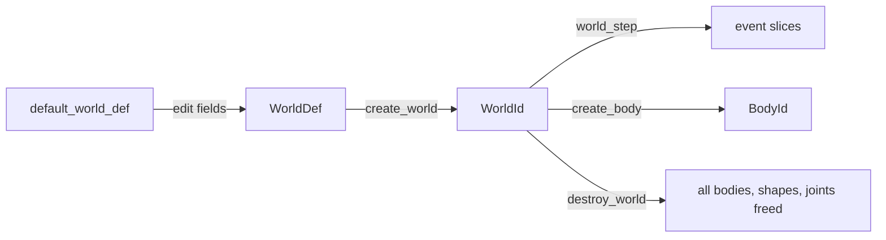

# Worlds and events

[Documentation](../index.md) › [Public API](index.md) › Worlds and events

Creating and stepping a world, its runtime settings, the task-system and solver callbacks, the
profile and counters, and the event arrays a step produces. Everything here is in module `b3`.



## Create and step

```c3
b3::WorldDef def = b3::default_world_def();
def.gravity = { 0.0f, -9.81f, 0.0f };
def.worker_count = 4;                     // built-in scheduler, four workers
b3::WorldId world = b3::create_world(&def)!;
defer b3::destroy_world(world);

for (int i = 0; i < 60; i++) {
    b3::world_step(world, 1.0f / 60.0f, 4);
}
```

`create_world` returns `INVALID_DEFINITION` for a null definition or one that did not come from
`default_world_def`. It returns `WORLD_LIMIT_REACHED` when `MAX_WORLDS` (128) worlds already
exist. Start from `default_world_def` every time. It fills gravity `(0, -10, 0)`, contact tuning,
thresholds scaled by the current [length unit](library_and_math.md#length-units), sleeping and
continuous collision on, and the definition marker the wrapper checks.

`destroy_world` frees every body, shape and joint in the world, its event arrays, and any
debug-shape handles (through `destroy_debug_shape`). Geometry the caller built (meshes, height
fields, hulls, compounds) is not freed; see [shapes](shapes.md#contracts). Destroying a world that
is recording ends the recording first.

`world_step(world, time_step, sub_step_count)` advances the world by `time_step` seconds.
box3d expects a fixed time step, usually `1/60`, and usually 4 sub-steps. A sub-step count below 1
is treated as 1. A `time_step` of 0 runs collision but not the solver: contacts update and bodies
do not move.

`WorldDef.capacity`, a `Capacity` of expected shape, body and contact counts, pre-sizes the
world's internal arrays. `world.max_capacity()` reports the high-water marks reached so far,
which can seed `capacity` next time. `WorldDef.user_data` is readable as `world.user_data()` and
replaceable with `world.set_user_data(p)`.

`world_count()` is the number of live worlds. `max_world_count()` is the most that have existed
at once since the process started; it is not a limit.

## Worker threads

`WorldDef.worker_count`, `enqueue_task` and `finish_task` select how a step runs:

| `worker_count` | `enqueue_task` and `finish_task` | Step runs on |
|---|---|---|
| above 0 | both set | your task system |
| above 1 | not both set | box3d's built-in scheduler, with its own threads |
| 0 or 1 | not both set | the calling thread |

The count is clamped to `MAX_WORKERS` (32).

```c3
fn void* enqueue_inline(b3::TaskFn task, void* task_context, void* user_context, ZString task_name) {
    task(task_context);
    return null;                       // ran serially: box3d skips finish_task for it
}

fn void finish_task(void* user_task, void* user_context) {
    // block until the job behind user_task has completed
}
```

```c3
b3::WorldDef def = b3::default_world_def();
def.worker_count = 8;
def.enqueue_task = &enqueue_inline;
def.finish_task = &finish_task;
def.user_task_context = null;             // handed to both callbacks as user_context
b3::WorldId world = b3::create_world(&def)!;
defer b3::destroy_world(world);
```

`EnqueueTaskFn` receives a box3d `TaskFn`, the context to call it with, your `user_task_context`,
and a task name for diagnostics. It returns a handle to your job, or null if it ran the task
before returning. box3d passes each non-null handle to `FinishTaskFn`, which must block until
that job has completed. `world_step` waits inside `finish_task` while holding its own stack, so
call it from a thread that can block, or from a fiber the callback can park. A job system that
cannot park a job's stack must not call `world_step` from inside a job: a job blocking on its own
sub-jobs can deadlock.

`world.set_worker_count(n)` changes how many partitions box3d splits work into, clamped to
`1..MAX_WORKERS`. It does not change which task system runs them: a world created single-threaded
stays on the calling thread. `world.worker_count()` reads it.

## Settings

```c3
world.set_gravity({ 0.0f, -20.0f, 0.0f });
world.set_hit_event_threshold(2.0f);
world.set_contact_tuning(hertz: 60.0f, damping_ratio: 5.0f, contact_speed: 3.0f);
world.enable_sleeping(false);
world.set_friction_callback(&min_friction);
```

| Getter | Setter | Meaning |
|---|---|---|
| `gravity()` | `set_gravity(v)` | world gravity; box3d has no fixed up axis |
| `restitution_threshold()` | `set_restitution_threshold(v)` | approach speed above which restitution applies |
| `hit_event_threshold()` | `set_hit_event_threshold(v)` | approach speed above which hit events are reported |
| `maximum_linear_speed()` | `set_maximum_linear_speed(v)` | per-body linear speed clamp |
| `contact_recycle_distance()` | `set_contact_recycle_distance(v)` | contact point reuse distance; 0 disables recycling |
| | `set_contact_tuning(hertz, damping_ratio, contact_speed)` | contact stiffness, bounce and push-out speed cap |
| `is_sleeping_enabled()` | `enable_sleeping(flag)` | whether bodies may sleep |
| `is_continuous_enabled()` | `enable_continuous(flag)` | continuous collision of dynamic against static bodies |
| `is_warm_starting_enabled()` | `enable_warm_starting(flag)` | solver warm starting; disabling it is for testing |
| | `enable_speculative(flag)` | speculative contacts; for testing |
| `awake_body_count()` | | bodies currently awake |
| `bounds()` | | a box covering the current simulation, possibly padded |

`world_rebuild_static_tree(world)` rebuilds the static broad-phase tree. box3d documents it as an
internal testing aid.

### Mixing callbacks

```c3
fn float min_friction(float friction_a, ulong material_a, float friction_b, ulong material_b) {
    return math::min(friction_a, friction_b);
}
```

A `FrictionFn` replaces box3d's `sqrt(a * b)` friction mixing. A `RestitutionFn` replaces its
`max(a, b)` restitution mixing. Set them on `WorldDef.friction_callback` and
`WorldDef.restitution_callback`, or later with `world.set_friction_callback(fn)` and
`world.set_restitution_callback(fn)`. Passing null restores box3d's default. The callbacks receive
the two materials' values and `user_material_id`s and no context pointer. box3d may call them
from a worker thread, and they must not touch the world. They run when a contact's manifold is
recomputed, so the call count is not one per pair per step.

## Pre-solve and custom filters

```c3
struct Ghost {
    b3::ShapeId shape;
}

fn bool is_ghost(b3::ShapeId shape, Ghost* ghost) {
    return shape.index1 == ghost.shape.index1 && shape.generation == ghost.shape.generation;
}

fn bool skip_ghost_contact(b3::ShapeId shape_a, b3::ShapeId shape_b, b3::Pos point, b3::Vec3 normal, void* context) {
    Ghost* ghost = context;
    return !is_ghost(shape_a, ghost) && !is_ghost(shape_b, ghost);
}

fn bool skip_ghost_pair(b3::ShapeId shape_a, b3::ShapeId shape_b, void* context) {
    Ghost* ghost = context;
    return !is_ghost(shape_a, ghost) && !is_ghost(shape_b, ghost);
}
```

```c3
world.set_pre_solve_callback(&skip_ghost_contact, &ghost);
world.set_custom_filter_callback(&skip_ghost_pair, &ghost);
```

A `PreSolveFn` runs once per contact update before the solver, with the first point of the first
manifold, for shape pairs where at least one
shape set `ShapeDef.enable_pre_solve_events`. Returning false disables the contact for that step.
A `CustomFilterFn` runs when two shapes are about to begin colliding, for pairs where at least one
shape set `ShapeDef.enable_custom_filtering`. Returning false stops the pair from colliding.

Both run on worker threads during `world_step`. They must be thread-safe and must not modify the
world. box3d stores the context pointer and passes it on every call, so it must outlive the
world or the next `set_*_callback` call.

## Events

After each `world_step`, the world holds arrays of what happened during that step. The accessors
return slices into those arrays.

```c3
foreach (event : world.contact_begin_touch_events()) {
    io::printfn("touch %d / %d", event.shape_id_a.index1, event.shape_id_b.index1);
}
foreach (event : world.contact_end_touch_events()) {
    if (!event.contact_id.is_valid()) continue;   // destroyed with its shape
}
foreach (event : world.contact_hit_events()) {
    io::printfn("hit at %s, %f m/s", event.point, event.approach_speed);
}
foreach (event : world.body_move_events()) {
    // event.transform is the end-of-step pose; event.user_data is the body's user data
}
```

| Accessor | Element | Reported when |
|---|---|---|
| `contact_begin_touch_events()` | `ContactBeginTouchEvent` | two shapes began touching; either shape set `enable_contact_events` |
| `contact_end_touch_events()` | `ContactEndTouchEvent` | two shapes stopped touching, including by destruction, teleport or a filter change; either shape set `enable_contact_events` |
| `contact_hit_events()` | `ContactHitEvent` | a contact closed faster than `hit_event_threshold`; either shape set `enable_hit_events` |
| `sensor_begin_touch_events()` | `SensorBeginTouchEvent` | a shape began overlapping a sensor; **both** shapes set `enable_sensor_events` |
| `sensor_end_touch_events()` | `SensorEndTouchEvent` | a shape stopped overlapping a sensor; both shapes set `enable_sensor_events` |
| `body_move_events()` | `BodyMoveEvent` | the simulation moved a body; no flag needed |
| `joint_events()` | `JointEvent` | an awake joint's force or torque exceeded its threshold |

Every shape event flag is off in `default_shape_def`. Set them on the
[shape definition](shapes.md).

- `ContactHitEvent` carries `point` (the midpoint between the surfaces at the start of the step,
  which may be a speculative point before contact), `normal` (from shape A to shape B),
  `approach_speed`, and both shapes' `user_material_id`.
- `BodyMoveEvent` carries the end-of-step `transform`, the body's `user_data`, and
  `fell_asleep`. Bodies the caller moved are not reported, and a sleeping body reports nothing
  until it wakes. Reading `transform` here avoids a `body.transform()` call per body when syncing
  render state.
- `JointEvent` carries `joint_id` and the joint's `user_data`; the force is not included.

### Event lifetime

The arrays belong to the world. The next `world_step` overwrites them, and `destroy_world` frees
them. Copy anything needed after that:

```c3
b3::ContactHitEvent[] kept = @clone_slice(world.contact_hit_events());
defer free(kept);
```

End events are double-buffered. An end caused between steps (destroying a body or shape,
`set_transform`, a filter change) appears after the next `world_step`, not immediately.

End events, sensor events and joint events can name objects that no longer exist. Check
`ContactId.is_valid()`, `ShapeId.is_valid()` or `JointId.is_valid()` before using an id from them.

## Diagnostics

```c3
b3::Profile profile = world.profile();
b3::Counters counters = world.counters();
io::printfn("step %.3f ms, %d bodies, %d contacts", profile.step, counters.body_count, counters.contact_count);
```

`Profile` holds the last step's timings in milliseconds, one field per solver stage. `Counters`
holds object counts, tree heights, memory use, per-colour constraint counts, and solver iteration
statistics.

`world_dump_memory_stats(world)` writes one line per internal store and a total in kilobytes to
the [log handler](library_and_math.md#log-and-assert-hooks). It writes nothing while the world is
locked.

`WorldDef.create_debug_shape` (`CreateDebugShapeFn`), `destroy_debug_shape` (`DestroyDebugShapeFn`)
and `user_debug_shape_context` give debug drawing per-shape renderer handles; see
[debug draw](debug_draw.md#shape-handles).

Explosions are `world_explode` and `ExplosionDef` on the
[character mover](character_mover.md) page. Debug drawing is [`draw::world_draw`](debug_draw.md),
and recording is [`record::world_start_recording`](recording.md).

## Contracts

- Always start from `default_world_def()`. An unmarked definition is refused with
  `INVALID_DEFINITION`.
- At most `MAX_WORLDS` worlds exist at once, including the private world of each live replay
  player.
- A world is locked during `world_step` and inside the callbacks it runs. Do not call setters or
  create or destroy objects while it is locked. Some calls are silently ignored on a locked world
  (`set_worker_count`, the mixing-callback setters); others are not checked at all and corrupt
  state.
- Friction, restitution, pre-solve and custom-filter callbacks may run on worker threads. They must
  not modify the world.
- The pre-solve and custom-filter context pointer must outlive the world.
- `finish_task` must block until its job completes. Do not call `world_step` from a job that
  cannot yield its stack.
- Event slices are valid until the next `world_step` or `destroy_world`.
- Sensor events need the flag on both shapes; contact, hit and pre-solve events need it on one.
- Ids in events may name destroyed objects. Test `is_valid()`.
