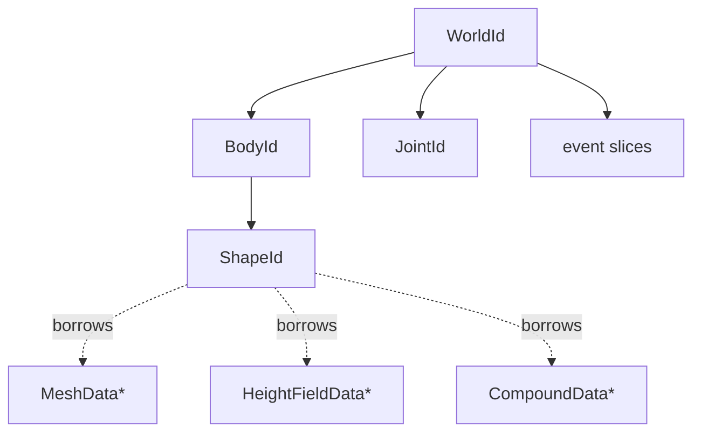

# Architecture

[Documentation](index.md) › Architecture

The binding model a consumer designs around: how the C API maps onto C3 names, what an identifier
is, where definitions come from, who owns what and for how long, how failures surface, which
threads call back, and what the shipped Release build of box3d does and does not check. Read this
before structuring an application around `b3`.

`b3` is a thin layer. Every C function keeps its behaviour; the wrapper layer changes its shape
(optionals, slices, return values instead of out-parameters) and adds guards where the shipped
box3d build would otherwise corrupt memory.

## Modules

| Module | Holds |
|---|---|
| `b3` | Worlds, bodies, shapes, joints, events, casts and queries, standalone geometry, the dynamic tree, the character mover, explosions, the library hooks, every fault |
| `b3::draw` | Debug draw: `draw::DebugDraw`, `draw::DebugShape`, `draw::default_debug_draw()`, `draw::world_draw()`, `draw::graph_color()` |
| `b3::record` | Recording and replay: `record::Recording`, `record::Player`, `record::create_recording()`, `record::world_start_recording()`, `record::create_player()` |

`import b3;` reaches all three, because C3 imports submodules recursively. Inside a module that
imports `b3`, the submodules are written `draw::` and `record::`.

The faults live in `b3` whichever module returns them. A `record::` call refuses with
`b3::NOT_A_RECORDING`, and `draw::graph_color()` with `b3::INDEX_OUT_OF_RANGE`.

Importing creates nothing. box3d has no global initialisation call; the first object is the world
`b3::create_world` returns.

## Names

The C prefix `b3` becomes the module and never appears inside an identifier. Functions and
variables are `snake_case`, types `PascalCase`, constants and enum values `SCREAMING_SNAKE_CASE`.
`b3::draw` and `b3::record` also absorb a longer prefix: `b3RecPlayer` is `record::Player`,
`b3HexColor` is `draw::HexColor`.

The C symbol decides whether a binding is a method or a free function:

- A symbol that reads or writes a property is a method on its type. `Get` is dropped and `Set` is
  kept: `b3Type_GetX` is `id.x()`, `b3Type_SetX` is `id.set_x(v)`. `b3Type_IsX` and `b3Type_AreX`
  are `id.is_x()` and `id.are_x()`. `b3Type_EnableX(bool)` is `id.enable_x(flag)`. A symbol with
  `Compute` in it is also a method: `body.compute_aabb()`.
- Every other symbol is a free function taking the receiver as its first argument, named from the
  C symbol with `b3` stripped and nothing reordered: `b3World_Step` is `b3::world_step(world, …)`.

| C | C3 |
|---|---|
| `b3CreateWorld(&def)` | `b3::create_world(&def)` |
| `b3DestroyWorld(world)` | `b3::destroy_world(world)` |
| `b3World_Step(world, dt, 4)` | `b3::world_step(world, dt, 4)` |
| `b3World_GetGravity(world)` | `world.gravity()` |
| `b3World_SetGravity(world, g)` | `world.set_gravity(g)` |
| `b3World_EnableSleeping(world, flag)` | `world.enable_sleeping(flag)` |
| `b3Body_IsAwake(body)` | `body.is_awake()` |
| `b3Body_ComputeAABB(body)` | `body.compute_aabb()` |
| `b3Body_ApplyForce(body, f, p, true)` | `b3::body_apply_force(body, f, p, true)` |
| `b3RayCastSphere(&sphere, &input)` | `b3::ray_cast_sphere(&sphere, input)` |
| `b3MakeBoxHull(hx, hy, hz)` | `b3::make_box_hull(hx, hy, hz)` |
| `b3World_Draw(world, &draw, mask)` | `draw::world_draw(world, &draw, mask)` |
| `b3RecPlayer_StepFrame(player)` | `record::player_step_frame(player)` |
| `b3RecPlayer_GetFrame(player)` | `player.frame()` |
| `b3AABB`, `b3WorldDef` | `b3::Aabb`, `b3::WorldDef` |
| `B3_MAX_WORLDS` | `b3::MAX_WORLDS` |
| `b3_dynamicBody` | `b3::BodyType.DYNAMIC` |

```c3
b3::Vec3 g = world.gravity();
world.set_gravity({ 0.0f, -9.81f, 0.0f });
bool awake = body.is_awake();
b3::world_step(world, 1.0f / 60.0f, 4);
b3::body_apply_force_to_center(body, { 0.0f, 10.0f, 0.0f }, true);
```

Four kinds of helper have no C counterpart and are methods regardless: the identifier predicates
`.is_null()` and `.checked()`, the joint narrowings `JointId.as_revolute()` and its seven siblings,
and the accessors that turn a C count-and-pointer pair into a slice (`world.contact_begin_touch_events()`,
`body.shapes(buffer)`).

The wrapper layer also reshapes signatures where C used a pattern C3 expresses directly:

- An out-parameter becomes the return value: `joint.constraint_tuning()` returns a
  `ConstraintTuning`, `body.closest_point(target)` a `ClosestPoint`.
- A count and a pointer become a slice, in and out: `b3::create_hull(points, max)` takes a
  `Vec3[]`; `body.shapes(buffer)` fills a caller slice and returns the filled prefix.
- A result struct with a `hit` flag becomes an optional that faults with `NO_HIT` on a miss,
  because box3d leaves the other fields undefined then.

## Identifiers

`WorldId`, `BodyId`, `ShapeId`, `JointId` and `ContactId` are small value structs declared to match
box3d's layout: an index, the owning world, and a generation counter. They are not pointers. Copy
them, store them in your own structs, and pass them by value.

```c3
struct Player {
    b3::BodyId body;
}

fn void? ids(Player* player) {
    if (!player.body.is_valid()) return;
    b3::Pos p = player.body.position();

    b3::ShapeId[8] buffer;
    foreach (shape : player.body.shapes(buffer[..])) {
        b3::Sphere sphere = shape.sphere() ?? { .radius = 0.0f };
        io::printfn("%.2f %.2f", p.y, sphere.radius);
    }
}
```

Three predicates answer different questions:

| Call | Answers | Cost |
|---|---|---|
| `id.is_null()` | Is this the zero identifier? A field test in C3. | none |
| `id.is_valid()` | Does box3d still hold this object? Checks that the world slot is occupied, the object slot is live, and the generation matches. | one call into box3d |
| `id.checked()` | Returns the id, or `INVALID_HANDLE` when it is null. It does not test liveness. | a field test |

When an object is destroyed its slot can be reused, and the generation tells a stale identifier
from the new occupant. Only `is_valid()` reads it. Every other call trusts its identifier: box3d's
own validity assertions are compiled out of the shipped build, so a stale or foreign identifier
passed to an ordinary getter or setter reads or writes whatever now occupies that slot. Test
`is_valid()` on any identifier that may have outlived its object, such as one held across frames
or one taken from an end-touch event.

`is_valid()` answers for the world the identifier names, not the world a call is made on. The joint
constructors compare the two themselves and refuse a body from another world with
`INVALID_DEFINITION`.

Identifiers do not support `==`; C3 does not compare structs. To recognise a body or shape, attach a
pointer with `set_user_data()` or a name, and read it back.

### Typed joint identifiers

Each joint type with accessors of its own has a typed identifier: `RevoluteJointId`,
`PrismaticJointId`, `DistanceJointId`, `MotorJointId`, `ParallelJointId`, `SphericalJointId`,
`WeldJointId`, `WheelJointId`. Each is an `inline JointId`, so the shared joint accessors take it
uncast. Its constructor returns it directly; from a plain `JointId`, `joint.as_revolute()` and its
siblings convert after checking that the joint is alive and of that type. They return
`INVALID_HANDLE` or `WRONG_JOINT_TYPE` otherwise, because a type-specific accessor on the wrong
joint reinterprets that joint's solver data.

Shapes have no typed identifiers. The typed shape getters (`shape.sphere()`, `shape.capsule()`,
`shape.hull()`, `shape.mesh()`, `shape.height_field()`) test the shape's type on each call and return
`WRONG_SHAPE_TYPE`. They do not test liveness.

## Definitions

Every object box3d creates from a definition (`WorldDef`, `BodyDef`, `ShapeDef`, and each joint's
`*JointDef`) must start from its `default_*_def()` function. Take the value, change fields, pass a
pointer to it:

```c3
b3::BodyDef def;
if (catch err = b3::create_body(world, &def)) {
    if (err == b3::INVALID_DEFINITION) io::printfn("definition did not come from default_body_def()");
}
```

The defaults are not zero. Gravity, friction, density, the identity rotation, the joint force
thresholds and more are set there, and each default carries a marker in its `internal_value` field.
box3d checks that marker with an assertion, which the shipped Release build compiles out: a zeroed
or hand-initialised definition would be accepted and produce a world with no gravity, a static body
at the origin, a massless shape, or a joint that reports an event every step. The wrappers check the
marker themselves and refuse with `INVALID_DEFINITION`, as they do for a null definition pointer.

Only the marker is restored. Field values are not validated: a zero quaternion, a negative density
or a NaN position passes through to box3d as it would in C.

Some definition-like structs have no marker and are filled field by field: `MeshDef`,
`HeightFieldDef`, `CompoundDef`, `ShapeProxy`. `ExplosionDef` has a default, but its fields are
checked individually by `b3::world_explode` instead.

## Ownership and lifetimes



A solid arrow means the parent destroys the child. A dotted arrow means the shape reads caller-owned
data that must outlive it.

### Objects in a world

Construction and destruction are free functions: `create_world`/`destroy_world`,
`create_body`/`destroy_body`, `create_*_shape`/`destroy_shape`, `create_*_joint`/`destroy_joint`.

`destroy_world` destroys every body, shape, joint and contact in the world and frees its event
arrays. It stops an active recording first, so the recording stays playable. Destroying a body
destroys its shapes and joints. Pair each `create_world` with a `defer b3::destroy_world(world)` on
the next line; individual bodies and shapes need no cleanup of their own when the world goes.

At most `MAX_WORLDS` (128) worlds exist at once; the next `create_world` returns
`WORLD_LIMIT_REACHED`.

### Geometry the caller owns

box3d allocates some geometry for the caller instead of for a world. The caller destroys each
exactly once, and destroying a world never frees it:

| Built by | Type | Destroy with |
|---|---|---|
| `create_mesh`, `create_grid_mesh` and the other mesh builders | `MeshData*` | `destroy_mesh` |
| `create_height_field`, `create_height_field_grid`, `create_height_field_wave`, `load_height_field` | `HeightFieldData*` | `destroy_height_field` |
| `create_compound` | `CompoundData*` | `destroy_compound` |
| `create_hull`, `create_cylinder`, `create_cone`, `create_rock`, `clone_hull`, `clone_and_transform_hull` | `HullData*` | `destroy_hull` |
| `record::create_recording`, `record::load_recording` | `record::Recording*` | `record::destroy_recording` |
| `record::create_player` | `record::Player*` | `record::destroy_player` |

A mesh, height field or compound shape borrows its geometry; it does not copy it. The geometry must
outlive every shape built on it. Destroying it first is a use-after-free that nothing reports. With
`defer`, register the geometry's destroy before creating the shape, so the shape goes first.

Hull shapes copy their hull, so a stack `BoxHull` or a hull destroyed right after
`create_hull_shape` is fine. `shape.hull()` returns the world's copy: never pass it to
`destroy_hull`. A `BoxHull` owns its storage inline; never call `destroy_hull` on its `base`.

A `record::Player` runs a private world of its own, which counts towards `world_count()` and
`MAX_WORLDS` until the player is destroyed.

`b3::byte_count()` reports everything box3d currently holds, worlds and caller-owned geometry
alike. A value that does not return to its starting point after teardown is a leak.

### Borrowed slices and pointers

Several accessors return memory the caller does not own. Each stays valid only as long as its
owner allows:

| Accessor | Valid until |
|---|---|
| `world.contact_begin_touch_events()`, `contact_end_touch_events()`, `contact_hit_events()`, `sensor_begin_touch_events()`, `sensor_end_touch_events()`, `body_move_events()`, `joint_events()` | The next `world_step` on that world, or `destroy_world` |
| `ContactData.contact_manifolds()` | The next `world_step`, or `destroy_world` |
| `body.shapes(buffer)`, `body.contact_data(buffer)`, `world_cast_ray_all(…, buffer)` and every other buffer filler | The caller's buffer: the result is its filled prefix |
| `record::Recording.data()` | The next recorded mutation, query or step, or `destroy_recording` |
| The `PlaneResult*` array passed to a `PlaneResultFn` | The end of that callback |
| The geometry arms of a `draw::DebugShape` | The end of that callback for spheres, capsules and meshes |
| `shape.hull()` | Until the shape is destroyed or given other geometry |

Copy out anything needed past those points. The durable handle for a contact is its `ContactId`,
which fetches the data again through `contact.data()`.

## Faults

Every operation that can fail returns an optional, `T?` or `void?`, carrying a named fault. No
wrapper returns a null identifier, a null pointer or a sentinel as an error. Propagate with `!`,
handle with `if (catch err = …)`, or supply a default with `??`.

The fault set and each fault's meaning are listed once, in the [API index](api/index.md#faults).
Each function's docstring lists the faults it returns and the exact condition for each.

Not every failure is a fault. Many box3d calls do nothing, or answer zero, when the world is locked
(during `world_step`, including inside its callbacks), and the wrappers forward that silence
unchanged unless the docstring says otherwise. Setters box3d does not validate, such as
`set_motor_speed` or `b3::set_length_units_per_meter`, return `void` and accept any value.

## Math types

box3d's vector, rotation and matrix types are the C3 standard library's, so the usual operators and
methods work on values that cross the ABI:

| box3d | `b3` | Standard library type |
|---|---|---|
| `b3Vec3` | `Vec3` | `float[<3>]` |
| `b3Quat` | `Quat` | `Quaternionf` |
| `b3Matrix3` | `Matrix3` | `Matrix3f` |
| `b3Pos` | `Pos` | a distinct `typedef` of `Vec3` |

`Pos` is a world position and is distinct from `Vec3`, so arithmetic that yields a `Vec3` needs an
explicit cast to be stored as a position: `(b3::Pos)(p + v * dt)`.

`Matrix3f` matches `b3Matrix3` byte for byte and shares its convention: column-major storage, with
`m * v` reading the columns `b3MulMV` reads. The field `m01` is row 0 of column 1, the transpose of
the order the C field names `cx`, `cy`, `cz` read in. A matrix filled from rows is silently
transposed.

## Threading

The API is single-threaded per world. box3d takes no lock around a world: call into one world from
one thread at a time. box3d also keeps process-wide state without locks, namely the world table,
the allocator, the log and assert hooks, and the length unit. Create and destroy worlds and install
hooks from one thread.

A step can use several threads internally. `WorldDef.worker_count` selects how:

| `worker_count` | Task callbacks | Behaviour |
|---|---|---|
| 1 or more | `enqueue_task` and `finish_task` both set | box3d runs its tasks on the caller's task system |
| above 1 | either one null | box3d starts its own scheduler threads |
| 1 | either one null | The step runs on the calling thread |
| 0 | any | The step runs on the calling thread |

The count is clamped to `MAX_WORKERS` (32). With a caller's task system, `enqueue_task` runs the
task exactly once on a worker thread, or runs it inline and returns null. `finish_task` blocks until
the task completes. `world_step` holds its stack across those waits, so do not call it from a job
that blocks on sub-jobs without yielding its thread: that can deadlock.

Callbacks fall into two groups:

| Callback | Runs on | Rules |
|---|---|---|
| `FrictionFn`, `RestitutionFn` | Any worker thread, during `world_step` | Thread-safe; no context pointer; must not touch the world |
| `PreSolveFn`, `CustomFilterFn` | Any worker thread, during `world_step` | Thread-safe; must not modify the world; the context must outlive the world |
| `TaskFn` (via `enqueue_task`) | The caller's worker threads | Must run exactly once per enqueue |
| `CastResultFn`, `OverlapResultFn`, `PlaneResultFn`, `MoverFilterFn`, `MeshQueryFn`, `CompoundQueryFn`, the dynamic tree callbacks | The calling thread, inside the query | Must not modify the world |
| `draw::DebugDraw` callbacks, `CreateDebugShapeFn` | The calling thread, inside `draw::world_draw` | Must not modify the world |
| `DestroyDebugShapeFn` | The thread destroying the shape or the world | |

Events are the thread-safe alternative to step callbacks. Read the event slices after
`world_step` returns and modify the world from there.

## Float ABI

The bindings are declared against box3d's single-precision layout. A box3d built with
`BOX3D_DOUBLE_PRECISION` widens `Pos` and every struct embedding it to double, and every call would
read the wrong bytes. The shipped libraries are single precision. Call `b3::require_float_abi()`
once at startup to refuse a library built otherwise; it returns `DOUBLE_PRECISION_LIBRARY`.

## Release build

The shipped libraries are box3d's Release configuration, so every `B3_ASSERT` in box3d is compiled
out. In C, those assertions are what catch a bad argument in a debug build. Here they never run.
`b3::set_assert_fn` is bound, but the shipped library never calls an assert handler.

The wrappers restore the checks whose absence corrupts memory, hangs, or returns undefined data:

- **Definition markers.** World, body, shape and joint definitions not taken from their default.
- **Null pointers box3d dereferences.** Definitions, geometry passed to shape constructors,
  `ShapeProxy` point arrays in the standalone casts and distance functions, compound child
  arrays, height field samples.
- **Indices.** Shape material indices, compound children, graph colours, replay bodies and queries,
  dynamic tree proxy ids.
- **Wrong-typed reads.** The typed shape getters and the joint narrowings.
- **Foreign or stale bodies in joint definitions,** which box3d would write through.
- **Counts and ranges** that box3d turns into huge allocations, unbounded loops or writes past an
  array: hull ring steps, mesh and height field grid counts, compound child counts, proxy point
  counts in the standalone casts, a cast `max_fraction` above 1, non-finite explosion parameters, non-unit directions.
- **Undefined results.** A miss from a cast or ray becomes `NO_HIT`.

What stays unchecked is anything that only produces a wrong simulation: a NaN or infinite position,
a non-unit quaternion, a negative density, mass or torque limit, an out-of-range tuning value. Those
behave as they do in a Release build of box3d from C. Three more things stay the caller's: an
identifier passed to an ordinary accessor (see [Identifiers](#identifiers)), the lifetime of
borrowed geometry, the `ShapeProxy` handed to a world or body cast or overlap, and the few remaining crashes each call's docstring names, such as a mesh shape
on a dynamic body inside an explosion's query box.

## Units

box3d works in metres by default. `b3::set_length_units_per_meter(units)` rescales its internal
tolerances (linear slop, speculative distance, the bounds limit, default density and thresholds) for
a game that uses other units. It is process-wide, read whenever box3d computes a tolerance, so set it
once at startup before creating anything. The value is not validated: a zero or negative unit is
accepted.

`b3::length_units_per_meter()` reads it back. A live `record::Player` sets it to the unit its
recording was made under, and restores the previous value when destroyed.

## Process-wide hooks

`b3::set_allocator`, `b3::set_log_fn` and `b3::set_assert_fn` replace box3d's defaults for the
whole process. Install them at startup, before any box3d allocation, and keep the allocator until
everything box3d allocated through it is freed: a block is freed through whichever free function is
installed at the time. `set_allocator(null, null)` restores the built-in allocator. The default log
handler cannot be reinstalled once replaced, and a null log handler crashes on the next message.
See [hooks](cookbook.md#allocator-log-and-assert-hooks).
